# Глава 7А. Визуализация и BI: глубже

В главе 7 ты научился строить основные графики. Здесь — как довести график до уровня, на котором его не стыдно показать руководителю, набор готовых рецептов для типовых аналитических задач и подробный разбор BI-инструментов: как они устроены внутри, где в них считают неправильно и как собрать дашборд, которым будут пользоваться.

Примеры на Matplotlib написаны на чистом NumPy, чтобы каждый можно было запустить отдельно. С таблицами pandas всё работает так же: вместо массивов передаются столбцы.

```python
import numpy as np
import matplotlib.pyplot as plt
from matplotlib.ticker import FuncFormatter, PercentFormatter

rng = np.random.default_rng(42)
```

## 7А.1. Из чего состоит график

Чтобы настраивать график, нужно знать названия его частей — по ним ищется всё остальное.

| Часть | Что это | Как обратиться |
|-------|---------|----------------|
| Figure | Весь рисунок | `fig` |
| Axes | Область одного графика | `ax` |
| Title | Заголовок | `ax.set_title()` |
| Axis label | Подпись оси | `ax.set_xlabel()`, `ax.set_ylabel()` |
| Ticks | Деления на оси | `ax.set_xticks()`, `ax.tick_params()` |
| Tick labels | Подписи делений | `ax.xaxis.set_major_formatter()` |
| Spines | Рамка: четыре линии по краям | `ax.spines["top"]` |
| Grid | Сетка | `ax.grid()` |
| Legend | Легенда | `ax.legend()` |
| Artist | Любой нарисованный элемент: линия, столбец, текст | возвращается методами `ax.plot()`, `ax.bar()` |

Правило: **все настройки делаются через `ax`**. Запомни одну строку — `fig, ax = plt.subplots()` — и дальше ищи нужный метод у `ax`.

## 7А.2. Свой стиль оформления

График по умолчанию выглядит как «график по умолчанию». Чтобы не настраивать каждый заново, один раз задай стиль и заведи функцию-помощник.

```python
plt.rcParams.update({
    "figure.figsize": (9, 4.5),
    "figure.dpi": 110,
    "font.size": 11,
    "axes.titlesize": 14,
    "axes.titleweight": "bold",
    "axes.titlelocation": "left",
    "axes.spines.top": False,
    "axes.spines.right": False,
    "axes.grid": True,
    "axes.grid.axis": "y",
    "grid.alpha": 0.3,
    "axes.axisbelow": True,
    "legend.frameon": False,
})

ACCENT = "#1f6f5c"      # главный цвет
MUTED = "#b5b5b5"       # всё второстепенное
WARNING = "#c44e52"     # плохое, падение


def finish(ax, title, subtitle=None, source=None):
    """Заголовок-вывод, поясняющий подзаголовок и источник данных."""
    ax.set_title(title, pad=28 if subtitle else 12)
    if subtitle:
        ax.text(0, 1.04, subtitle, transform=ax.transAxes, color="#666666", fontsize=10.5)
    if source:
        ax.figure.text(0.01, 0.005, f"Источник: {source}", color="#999999", fontsize=8.5)
    ax.figure.tight_layout()
```

`plt.rcParams` — глобальные настройки: они действуют на все графики ноутбука. Три цвета с понятными ролями заменяют радугу: один акцентный, один нейтральный и один для тревожного.

Такой блок удобно держать в отдельном файле `style.py` и импортировать в начале каждого ноутбука — графики всего проекта будут выглядеть единообразно.

## 7А.3. Оси: числа, проценты, даты

Подписи вида `2000000` и `0.0525` заставляют читателя считать нули. Формат задаётся форматтером.

```python
months = np.arange(1, 13)
revenue = 1_800_000 + 90_000 * months + rng.normal(0, 60_000, 12)
conversion = 0.045 + 0.001 * months + rng.normal(0, 0.002, 12)

fig, (ax1, ax2) = plt.subplots(1, 2, figsize=(11, 4))

ax1.plot(months, revenue, color=ACCENT, marker="o")
ax1.yaxis.set_major_formatter(FuncFormatter(lambda value, _: f"{value / 1e6:.1f} млн"))
ax1.set_ylim(0, revenue.max() * 1.15)
ax1.set_xticks(months)
ax1.set_title("Выручка, руб.")

ax2.plot(months, conversion, color=ACCENT, marker="o")
ax2.yaxis.set_major_formatter(PercentFormatter(xmax=1, decimals=1))
ax2.set_xticks(months)
ax2.set_title("Конверсия")

fig.tight_layout()
plt.show()
```

<!-- result -->
*Результат:*

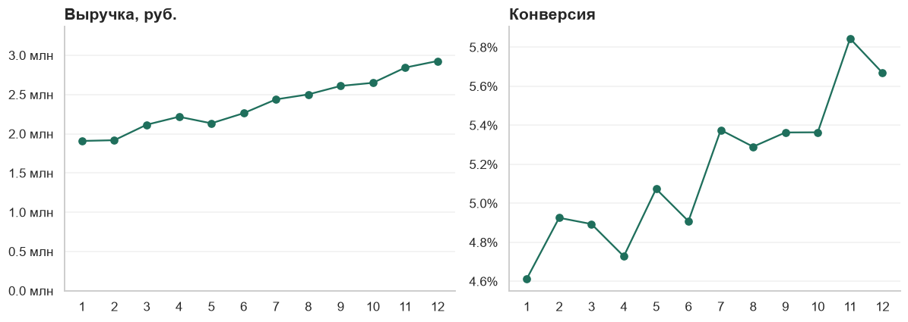
<!-- /result -->


- `FuncFormatter` принимает функцию «число → строка»: так делают тысячи, миллионы, рубли.
- `PercentFormatter(xmax=1)` превращает доли в проценты: `0.05` → `5.0%`.
- `set_ylim(0, ...)` начинает ось с нуля. Для столбцов это обязательно, для линий — по ситуации: если важен уровень, начинай с нуля; если важны колебания — можно обрезать, но тогда не делай выводов о масштабе изменений.

### Даты на оси

```python
import matplotlib.dates as mdates

days = np.arange("2026-01-01", "2026-04-01", dtype="datetime64[D]")
orders = 120 + 0.4 * np.arange(len(days)) + rng.normal(0, 12, len(days))

fig, ax = plt.subplots()
ax.plot(days, orders, color=ACCENT)
ax.xaxis.set_major_locator(mdates.MonthLocator())             # деление в начале каждого месяца
ax.xaxis.set_major_formatter(mdates.DateFormatter("%d.%m"))   # формат подписи
ax.xaxis.set_minor_locator(mdates.WeekdayLocator(byweekday=0))  # мелкие деления по понедельникам
finish(ax, "Заказы по дням")
plt.show()
```

<!-- result -->
*Результат:*

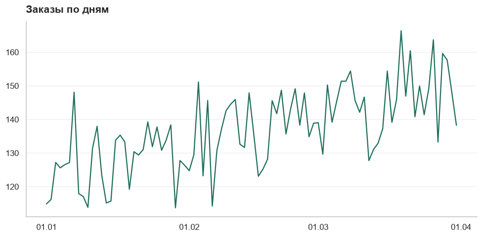
<!-- /result -->


`Locator` решает, **где** стоят деления, `Formatter` — **как** они подписаны.

### Логарифмическая шкала

Когда значения различаются на порядки, на обычной шкале маленькие сливаются в линию у нуля:

```python
categories = ["Москва", "Петербург", "Казань", "Уфа", "Тверь"]
users = np.array([1_200_000, 480_000, 95_000, 41_000, 6_000])

fig, ax = plt.subplots(figsize=(8, 3.5))
ax.barh(categories[::-1], users[::-1], color=ACCENT)
ax.set_xscale("log")
ax.xaxis.set_major_formatter(FuncFormatter(lambda v, _: f"{v:,.0f}".replace(",", " ")))
finish(ax, "Пользователи по городам", subtitle="Логарифмическая шкала: каждое деление — в 10 раз больше")
plt.show()
```

<!-- result -->
*Результат:*

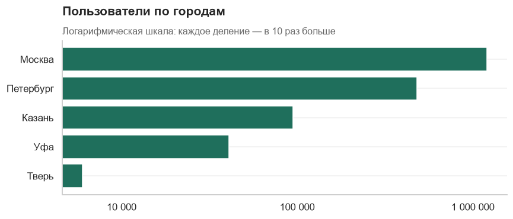
<!-- /result -->


Логарифмическую шкалу обязательно подписывай: читатель, не заметивший её, сделает неверный вывод о соотношении величин.

## 7А.4. Аннотации и выделение главного

Аналитический график отличается от иллюстрации тем, что **показывает, куда смотреть**.

```python
weeks = np.arange(1, 21)
conversion = np.r_[rng.normal(0.050, 0.002, 11), rng.normal(0.058, 0.002, 9)]

fig, ax = plt.subplots()
ax.plot(weeks, conversion, color=ACCENT, linewidth=2.2, marker="o", markersize=4)

ax.axvline(11.5, color="#666666", linestyle="--", linewidth=1)              # момент события
ax.axvspan(11.5, 20.5, color=ACCENT, alpha=0.07)                            # период после
ax.annotate(
    "Запуск новой корзины",
    xy=(11.5, 0.0575), xytext=(5.5, 0.0605),
    arrowprops={"arrowstyle": "->", "color": "#666666"}, color="#444444",
)

before, after = conversion[:11].mean(), conversion[11:].mean()
ax.hlines([before, after], [1, 12], [11, 20], color=MUTED, linestyle=":")
ax.text(1, before - 0.0012, f"среднее {before:.1%}", color="#666666")
ax.text(15.5, after + 0.0008, f"среднее {after:.1%}", color="#666666")

ax.yaxis.set_major_formatter(PercentFormatter(xmax=1, decimals=1))
ax.set_xlabel("Неделя")
finish(ax, f"После запуска новой корзины конверсия выросла с {before:.1%} до {after:.1%}",
       subtitle="Конверсия в заказ по неделям")
plt.show()
```

<!-- result -->
*Результат:*

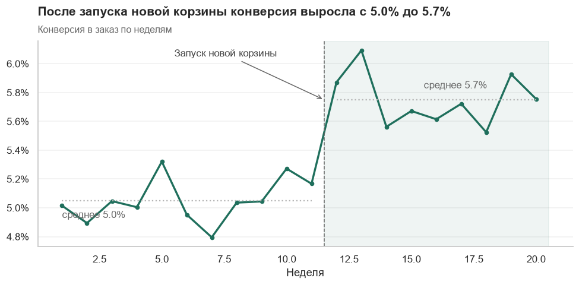
<!-- /result -->


Инструменты выделения:

| Метод | Что рисует | Для чего |
|-------|-----------|----------|
| `ax.axvline(x)` / `ax.axhline(y)` | Вертикальная / горизонтальная линия | Событие, цель, порог |
| `ax.axvspan(x1, x2)` | Закрашенная полоса | Период: акция, сбой, праздники |
| `ax.annotate(text, xy, xytext)` | Подпись со стрелкой | Объяснение конкретной точки |
| `ax.text(x, y, text)` | Текст | Значения, пояснения |
| `ax.bar_label(bars)` | Числа над столбцами | Когда важны точные значения |

### Подписи вместо легенды

Легенда заставляет глаз прыгать между линией и расшифровкой. Подпиши линии прямо у их концов:

```python
x = np.arange(1, 13)
series = {
    "Москва": 100 + 8 * x + rng.normal(0, 4, 12),
    "Казань": 80 + 3 * x + rng.normal(0, 4, 12),
    "Уфа": 70 + 1 * x + rng.normal(0, 4, 12),
    "Самара": 60 + 2 * x + rng.normal(0, 4, 12),
}

fig, ax = plt.subplots()
for name, values in series.items():
    is_main = name == "Москва"
    ax.plot(x, values, color=ACCENT if is_main else MUTED, linewidth=2.6 if is_main else 1.4)
    ax.text(12.2, values[-1], name, va="center", color=ACCENT if is_main else "#777777",
            fontweight="bold" if is_main else "normal")

ax.set_xlim(1, 13.6)
ax.set_xticks(x)
ax.grid(False)
finish(ax, "Москва растёт втрое быстрее остальных городов", subtitle="Заказы в месяц, тыс.")
plt.show()
```

<!-- result -->
*Результат:*

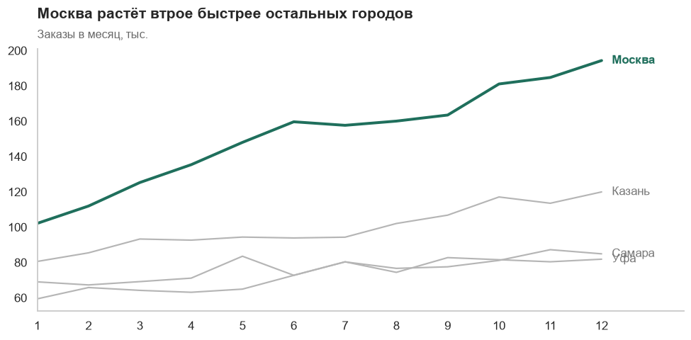
<!-- /result -->


Один город выделен цветом и толщиной, остальные серые — это приём «акцент на фоне контекста». Он решает проблему «спагетти» из десяти разноцветных линий.

## 7А.5. Цвет

Цвет должен что-то **означать**. Три типа палитр — три типа данных:

| Тип | Когда | Примеры в Matplotlib |
|-----|-------|----------------------|
| **Категориальная** | Разные группы без порядка | `tab10`, `Set2` |
| **Последовательная** | Величина от малого к большому | `Blues`, `Greens`, `viridis` |
| **Расходящаяся** | Отклонение от центра в обе стороны | `RdBu`, `coolwarm` |

Правила:

- **Категорий с разными цветами — не больше пяти-шести.** Остальное объединяй в «Прочие» или выделяй одну на сером фоне.
- **Один и тот же объект — всегда один и тот же цвет** на всех графиках отчёта.
- **Расходящаяся палитра должна быть центрирована** на осмысленном значении — нуле, плане, среднем. Задаётся параметрами `vmin`, `vmax` или `center`.
- **Красный и зелёный несут смысл** «плохо» и «хорошо». Не используй их для нейтральных категорий.
- **Учитывай дальтонизм:** красный и зелёный одинаковой яркости для части людей неразличимы. Дублируй смысл знаком, подписью или формой. Палитры `viridis` и `cividis` читаются при любом цветовосприятии.
- **Радужные палитры (`jet`, `rainbow`) не используй:** они создают ложные границы там, где данные меняются плавно.

## 7А.6. Рецепты

Восемь графиков, которые закрывают большинство задач отчёта.

### Линия с доверительным интервалом

Показывает не только оценку, но и её неопределённость:

```python
days = np.arange(1, 31)
visitors = rng.integers(1800, 2600, 30)
orders = rng.binomial(visitors, 0.05 + 0.0004 * days)

cr = orders / visitors
se = np.sqrt(cr * (1 - cr) / visitors)

fig, ax = plt.subplots()
ax.fill_between(days, cr - 1.96 * se, cr + 1.96 * se, color=ACCENT, alpha=0.18, label="95 % интервал")
ax.plot(days, cr, color=ACCENT, linewidth=2, label="Конверсия")
ax.yaxis.set_major_formatter(PercentFormatter(xmax=1, decimals=1))
ax.set_xlabel("День месяца")
ax.legend(loc="upper left")
finish(ax, "Дневные колебания конверсии укладываются в интервал неопределённости")
plt.show()
```

<!-- result -->
*Результат:*

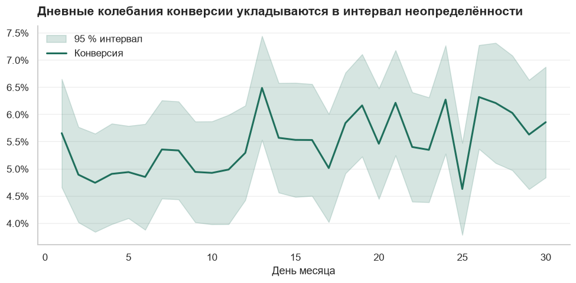
<!-- /result -->


Без полосы интервала каждый зубец на графике хочется объяснить. С полосой видно, что большинство зубцов — шум.

### Малые кратные (small multiples)

Вместо одного перегруженного графика — сетка одинаковых маленьких:

```python
segments = ["Новые", "Вернувшиеся", "Постоянные", "Спящие", "VIP", "Оптовые"]
x = np.arange(1, 13)

fig, axes = plt.subplots(2, 3, figsize=(11, 5.5), sharex=True, sharey=True)
for ax, name in zip(axes.flat, segments):
    values = 100 + rng.normal(0, 6, 12).cumsum() + rng.uniform(-20, 20)
    color = ACCENT if values[-1] >= values[0] else WARNING
    ax.plot(x, values, color=color, linewidth=2)
    ax.fill_between(x, values, values.min() - 5, color=color, alpha=0.08)
    ax.set_title(f"{name}: {values[-1] / values[0] - 1:+.0%}", fontsize=11)

fig.suptitle("Динамика заказов по сегментам за год", x=0.01, ha="left", fontweight="bold", fontsize=14)
fig.tight_layout()
plt.show()
```

<!-- result -->
*Результат:*

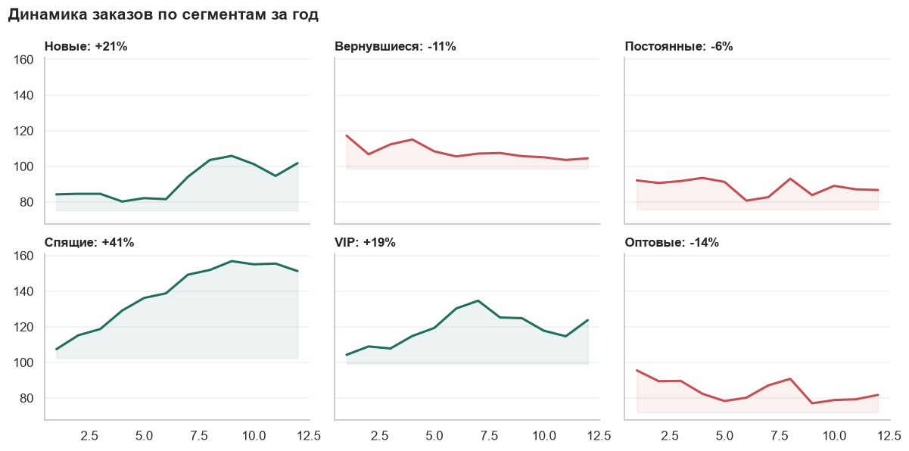
<!-- /result -->


`sharey=True` задаёт общую ось Y — без неё сравнивать панели между собой нельзя. Каждая панель подписана главным числом, цвет кодирует направление.

### Диаграмма Парето

Столбцы по убыванию плюс накопленная доля — «какие немногие причины дают основной эффект»:

```python
reasons = ["Долгая доставка", "Цена", "Не тот товар", "Брак", "Передумал", "Ошибка оплаты", "Другое"]
counts = np.array([420, 310, 150, 90, 60, 40, 30])

cumulative = counts.cumsum() / counts.sum()

fig, ax = plt.subplots()
bars = ax.bar(reasons, counts, color=[ACCENT if c <= 0.8 else MUTED for c in cumulative])
ax.bar_label(bars, padding=2, fontsize=9)
ax.tick_params(axis="x", rotation=25)
ax.grid(False)

ax2 = ax.twinx()
ax2.plot(reasons, cumulative, color="#444444", marker="o", linewidth=1.5)
ax2.axhline(0.8, color="#888888", linestyle=":", linewidth=1)
ax2.set_ylim(0, 1.05)
ax2.yaxis.set_major_formatter(PercentFormatter(xmax=1))
ax2.spines["right"].set_visible(True)
ax2.grid(False)

finish(ax, "Три причины дают 80 % отмен заказов", subtitle="Число отмен по причинам и накопленная доля")
plt.show()
```

<!-- result -->
*Результат:*

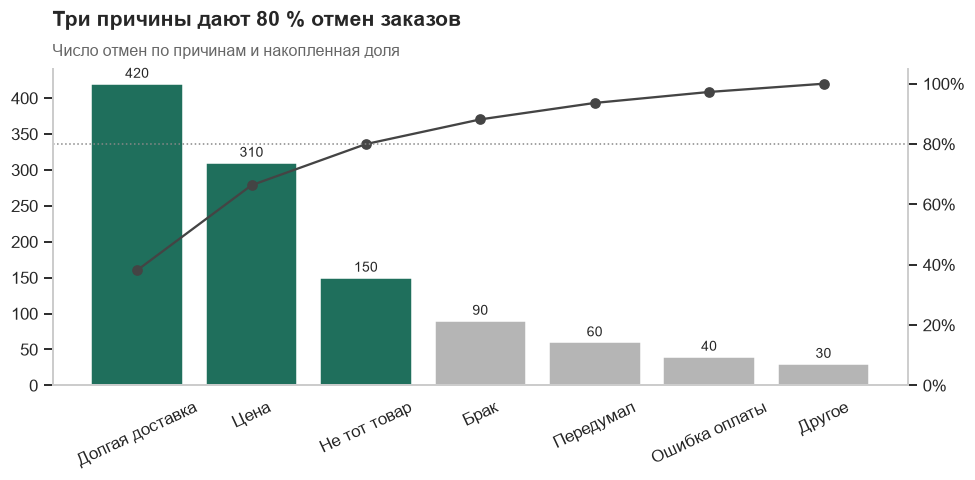
<!-- /result -->


Это один из немногих случаев, где вторая ось Y оправданна: обе оси описывают одну и ту же величину — количество и его накопленную долю.

### «Гантели»: сравнение до и после

```python
cities = np.array(["Самара", "Уфа", "Пермь", "Казань", "Москва"])
before = np.array([0.031, 0.034, 0.040, 0.043, 0.052])
after = np.array([0.036, 0.033, 0.049, 0.050, 0.055])

fig, ax = plt.subplots(figsize=(8, 3.8))
for i, (b, a) in enumerate(zip(before, after)):
    ax.plot([b, a], [i, i], color=ACCENT if a >= b else WARNING, linewidth=2.5, zorder=1)
ax.scatter(before, range(len(cities)), color="white", edgecolor="#555555", s=70, zorder=2, label="До")
ax.scatter(after, range(len(cities)), color="#333333", s=70, zorder=2, label="После")

ax.set_yticks(range(len(cities)), cities)
ax.xaxis.set_major_formatter(PercentFormatter(xmax=1, decimals=1))
ax.grid(axis="y", visible=False)
ax.grid(axis="x", alpha=0.3)
ax.legend(loc="upper left", ncols=2)
finish(ax, "Конверсия выросла во всех городах, кроме Уфы", subtitle="Конверсия до и после редизайна")
plt.show()
```

<!-- result -->
*Результат:*

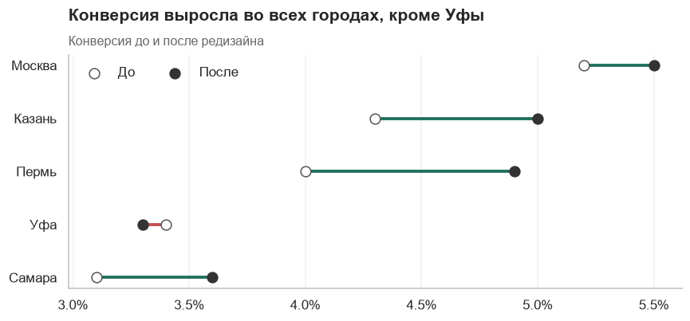
<!-- /result -->


Длина отрезка показывает размер изменения, цвет — направление. Две группы столбцов рядом передали бы то же самое гораздо хуже.

### Каскадная диаграмма (waterfall)

Показывает, **из чего складывается** изменение метрики:

```python
labels = ["Выручка\nянварь", "Новые\nклиенты", "Рост\nчека", "Отток", "Скидки", "Выручка\nфевраль"]
deltas = [0, 320, 140, -210, -90, 0]
start = 1200

values, bottoms, colors = [], [], []
level = start
for i, delta in enumerate(deltas):
    if i == 0 or i == len(deltas) - 1:            # итоговые столбцы стоят на нуле
        values.append(level)
        bottoms.append(0)
        colors.append("#555555")
    else:                                         # изменения «висят» на текущем уровне
        values.append(abs(delta))
        bottoms.append(level if delta >= 0 else level + delta)
        colors.append(ACCENT if delta >= 0 else WARNING)
        level += delta

fig, ax = plt.subplots()
bars = ax.bar(labels, values, bottom=bottoms, color=colors, width=0.62)
for bar, delta, value in zip(bars, deltas, values):
    text = f"{value:,.0f}" if delta == 0 else f"{delta:+,.0f}"
    ax.text(bar.get_x() + bar.get_width() / 2, bar.get_y() + bar.get_height() + 18, text, ha="center", fontsize=10)

ax.set_ylim(0, 1900)
ax.grid(False)
finish(ax, "Выручка выросла на 13 %: новые клиенты перекрыли отток",
       subtitle="Факторы изменения выручки, тыс. руб.")
plt.show()
```

<!-- result -->
*Результат:*

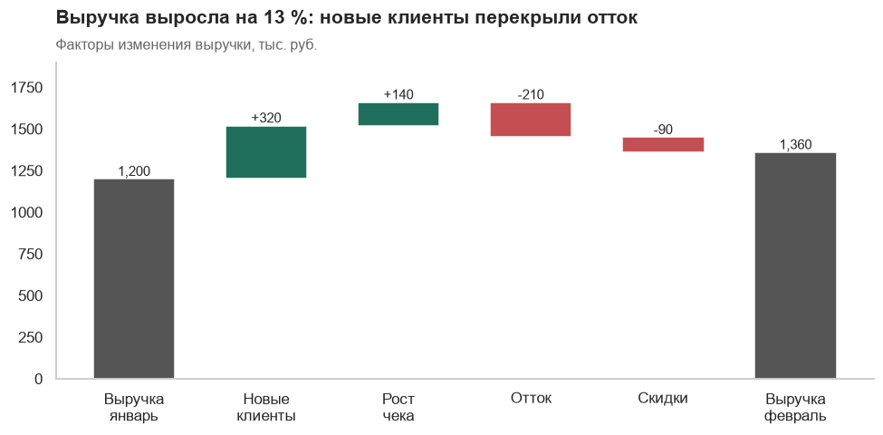
<!-- /result -->


Это график-объяснение: он отвечает на вопрос «почему изменилась метрика» и напрямую продолжает разложение из раздела 10.7.

### Доли: столбцы до 100 %

Когда важна **структура**, а не абсолютные значения:

```python
months_labels = ["Янв", "Фев", "Мар", "Апр", "Май", "Июн"]
channels = {
    "Поиск": np.array([40, 39, 37, 35, 33, 31]),
    "Реклама": np.array([35, 34, 33, 33, 32, 31]),
    "Рекомендации": np.array([15, 17, 20, 22, 25, 28]),
    "Прочее": np.array([10, 10, 10, 10, 10, 10]),
}
palette = {"Поиск": "#9aa5ad", "Реклама": "#c9cfd3", "Рекомендации": ACCENT, "Прочее": "#e6e8ea"}

fig, ax = plt.subplots()
bottom = np.zeros(len(months_labels))
for name, values in channels.items():
    bars = ax.bar(months_labels, values, bottom=bottom, color=palette[name], label=name, width=0.7)
    if name == "Рекомендации":
        ax.bar_label(bars, labels=[f"{v}%" for v in values], label_type="center", color="white", fontweight="bold")
    bottom += values

ax.yaxis.set_major_formatter(PercentFormatter(xmax=100))
ax.grid(False)
ax.legend(loc="upper center", bbox_to_anchor=(0.5, -0.08), ncols=4)
finish(ax, "Доля рекомендаций в заказах за полгода выросла почти вдвое", subtitle="Структура заказов по каналам")
plt.show()
```

<!-- result -->
*Результат:*

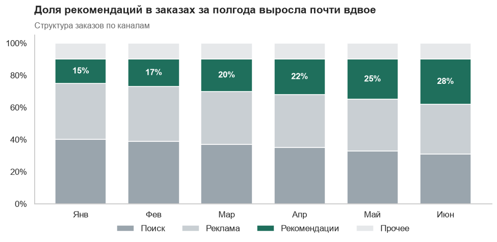
<!-- /result -->


Легко сравнить можно только нижний и верхний слои — у них ровная опорная линия. Поэтому главную категорию ставят вниз или выделяют цветом и подписывают, как здесь.

### Точечный график с линией тренда

```python
ad_spend = rng.uniform(50, 500, 60)
new_users = 20 + 0.9 * ad_spend + rng.normal(0, 55, 60)

slope, intercept = np.polyfit(ad_spend, new_users, deg=1)
correlation = np.corrcoef(ad_spend, new_users)[0, 1]
line_x = np.array([ad_spend.min(), ad_spend.max()])

fig, ax = plt.subplots(figsize=(7, 4.5))
ax.scatter(ad_spend, new_users, color=ACCENT, alpha=0.55, s=32)
ax.plot(line_x, intercept + slope * line_x, color="#333333", linewidth=1.5)
ax.text(0.03, 0.92, f"r = {correlation:.2f}\nкаждая 1 тыс. руб. ≈ {slope:.1f} пользователя",
        transform=ax.transAxes, va="top", color="#444444")
ax.set_xlabel("Расходы на рекламу в день, тыс. руб.")
ax.set_ylabel("Новые пользователи")
ax.grid(True, axis="both", alpha=0.25)
finish(ax, "Чем больше расходы на рекламу, тем больше новых пользователей")
plt.show()
```

<!-- result -->
*Результат:*

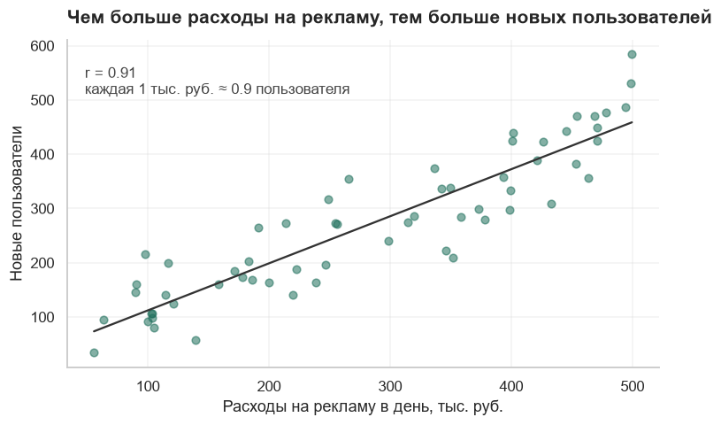
<!-- /result -->


`transform=ax.transAxes` размещает текст в долях области графика (от 0 до 1), а не в единицах данных: подпись остаётся в углу при любых значениях.

### Распределение: гистограмма и ECDF

```python
checks = rng.lognormal(7.6, 0.8, 5000)

fig, (ax1, ax2) = plt.subplots(1, 2, figsize=(11, 4))

ax1.hist(checks, bins=60, range=(0, 12_000), color=ACCENT, alpha=0.85)
top = ax1.get_ylim()[1]
for value, name, color, height in [(np.median(checks), "медиана", "#222222", 0.95), (checks.mean(), "среднее", WARNING, 0.78)]:
    ax1.axvline(value, color=color, linestyle="--", linewidth=1.3)
    ax1.text(value + 200, top * height, f"{name} {value:,.0f}", color=color, fontsize=9.5)
ax1.set_title("Гистограмма")
ax1.set_xlabel("Сумма чека, руб.")

sorted_checks = np.sort(checks)
share = np.arange(1, len(checks) + 1) / len(checks)
ax2.plot(sorted_checks, share, color=ACCENT, linewidth=2)
for q in (0.5, 0.9):
    value = np.quantile(checks, q)
    ax2.plot([0, value, value], [q, q, 0], color="#888888", linestyle=":", linewidth=1)
    ax2.text(value + 150, q - 0.06, f"{q:.0%} чеков ≤ {value:,.0f}", fontsize=9.5)
ax2.set_xlim(0, 12_000)
ax2.yaxis.set_major_formatter(PercentFormatter(xmax=1))
ax2.set_title("Накопленная доля (ECDF)")
ax2.set_xlabel("Сумма чека, руб.")

fig.tight_layout()
plt.show()
```

<!-- result -->
*Результат:*

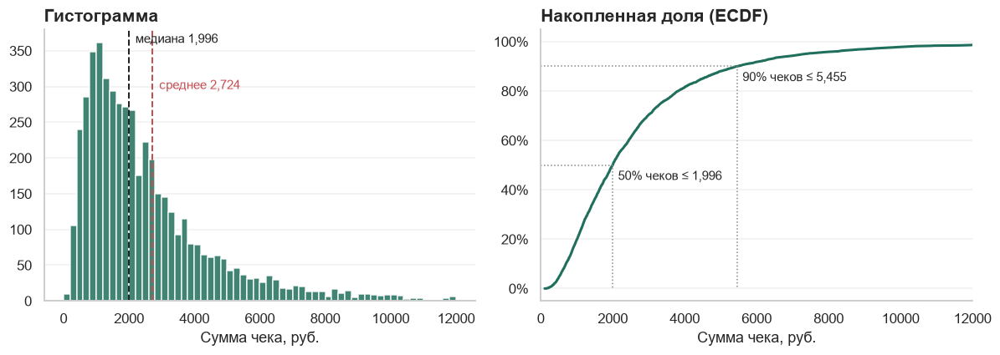
<!-- /result -->


ECDF — эмпирическая функция распределения: для каждого значения показывает, какая доля наблюдений не превышает его. В отличие от гистограммы, она не зависит от выбора ширины столбцов и позволяет прямо с графика читать перцентили. Две ECDF на одних осях — лучший способ сравнить распределения двух групп A/B-теста.

### Когортная тепловая карта

```python
cohorts = ["Янв", "Фев", "Мар", "Апр", "Май", "Июн"]
retention = np.full((6, 6), np.nan)
for i in range(6):
    for j in range(6 - i):
        retention[i, j] = 1.0 if j == 0 else (0.42 + 0.02 * i) * 0.8 ** (j - 1) + rng.normal(0, 0.01)

shown = retention[:-1, 1:]            # без нулевого месяца и без последней когорты: у неё ещё нет истории

fig, ax = plt.subplots(figsize=(8, 4.2))
image = ax.imshow(shown, cmap="Greens", vmin=0, vmax=0.6, aspect="auto")

for i in range(5):
    for j in range(1, 6):
        value = retention[i, j]
        if not np.isnan(value):
            ax.text(j - 1, i, f"{value:.0%}", ha="center", va="center",
                    color="white" if value > 0.35 else "#222222", fontsize=10)

ax.set_xticks(range(5), [f"Месяц {m}" for m in range(1, 6)])
ax.set_yticks(range(5), cohorts[:-1])
ax.grid(False)
ax.spines[["left", "bottom"]].set_visible(False)
ax.tick_params(length=0)
finish(ax, "Каждая новая когорта удерживается лучше предыдущей", subtitle="Доля вернувшихся по месяцам жизни когорты")
plt.show()
```

<!-- result -->
*Результат:*

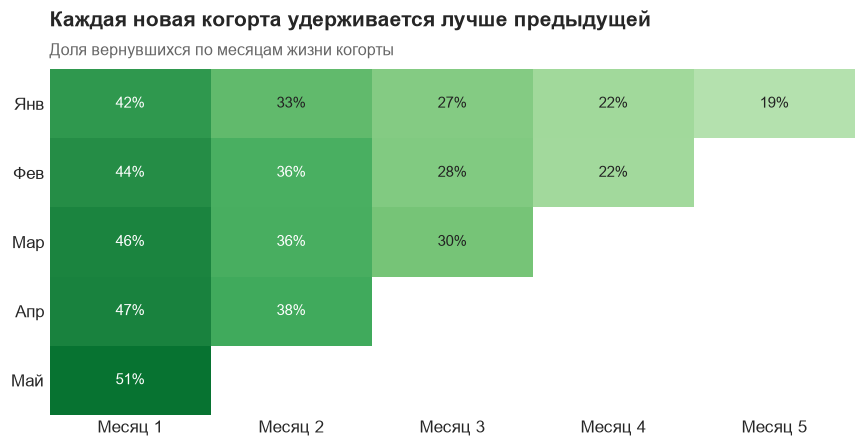
<!-- /result -->


Нулевой месяц (всегда 100 %) убран: он занимал бы самый тёмный цвет и «съедал» контраст остальных ячеек. Последняя когорта тоже не показана — у неё пока есть только нулевой месяц. Цвет текста переключается в зависимости от фона — иначе подписи на тёмных ячейках не прочитать.

## 7А.7. Чего не делать

| Антипаттерн | Почему плохо | Что вместо |
|-------------|--------------|------------|
| Две оси Y с разными величинами | Подбором масштабов можно «доказать» любую связь | Два графика один под другим с общей осью X |
| Трёхмерные столбцы и круги | Перспектива искажает размеры | Обычный плоский график |
| Круговая диаграмма с 8 секторами | Углы плохо сравниваются | Отсортированные горизонтальные столбцы |
| Десять цветных линий | Невозможно проследить ни одну | Акцент на одной, малые кратные |
| Столбцы не с нуля | Разница в 2 % выглядит как двукратная | Ось от нуля или точечный график |
| Легенда из 12 пунктов | Глаз мечется между графиком и легендой | Прямые подписи, объединение в «Прочие» |
| Накопительный итог вместо значений | Растёт всегда, скрывает замедление | Значения по периодам |
| Сортировка по алфавиту | Не видно лидеров и отстающих | Сортировка по значению |
| Неполный последний период | Выглядит как обвал | Отбросить или показать пунктиром |
| Заголовок «График 3» | Не сообщает ничего | Заголовок-вывод |

Про последний пункт таблицы особо: неполный последний месяц или неделя — самая частая причина ложной тревоги «у нас всё упало!».

## 7А.8. Интерактивные графики

Для исследования данных удобны графики, где можно навести мышь, увеличить фрагмент и отключить серию. Самая популярная библиотека — Plotly:

```bash
pip install plotly
```

```python
import plotly.express as px

fig = px.line(df, x="date", y="revenue", color="city", title="Выручка по городам")
fig.show()

fig = px.scatter(users, x="orders", y="revenue", color="segment", hover_data=["user_id"], trendline="ols")
fig.write_html("scatter.html")          # самостоятельный файл, открывается в любом браузере
```

Когда что использовать:

| Задача | Инструмент |
|--------|-----------|
| График в отчёт, презентацию, README | Matplotlib, seaborn — статичная картинка |
| Самому покрутить данные в ноутбуке | Plotly |
| Регулярный отчёт для других людей | BI-система |

Интерактивность не заменяет вывод: если читателю нужно наводить мышь, чтобы понять главное, — график не доделан.

## 7А.9. Как устроен BI-инструмент

DataLens, Tableau, Power BI, Superset и Metabase выглядят по-разному, но устроены одинаково. Поняв схему, ты разберёшься в любом из них за пару дней.

```
Источник данных  →  Модель данных  →  Показатели  →  Чарты  →  Дашборд
(база, файл)        (таблицы и связи)  (формулы)      (графики)  (страница с фильтрами)
```

### Измерения и показатели

Главное разделение во всех BI-системах:

- **Измерение (dimension)** — то, **по чему** режем: дата, город, категория, канал. Обычно текст или дата.
- **Показатель (measure)** — то, **что** считаем: выручка, число заказов, конверсия. Всегда результат агрегации.

Собрать график — значит ответить: какой показатель, в разрезе каких измерений. «Выручка по месяцам в разрезе городов» — один показатель и два измерения. Это тот же `GROUP BY` и та же сводная таблица.

### Модель данных: схема «звезда»

В BI данные обычно организуют так:

- **Таблица фактов** — события: заказы, платежи, визиты. Длинная, содержит числа и ключи.
- **Таблицы измерений (справочники)** — описания: клиенты, товары, календарь. Короткие, содержат атрибуты.

```
        Клиенты                 Товары
           │                      │
           └────► Заказы ◄────────┘
                    ▲
                    │
                Календарь
```

Факты в центре, справочники вокруг — отсюда название. Связи всегда «один ко многим»: один клиент — много заказов.

Почему так, а не одной огромной таблицей:

- название города хранится один раз, а не в миллионе строк;
- справочник легко поправить и дополнить;
- фильтр по справочнику автоматически фильтрует факты.

Отдельно важна **таблица-календарь**: строка на каждый день с признаками — месяц, квартал, день недели, праздник. Она решает проблему пропущенных дат (раздел 3А.8) и даёт удобные группировки по времени.

### Зерно

Тот же вопрос, что в SQL: **что означает одна строка** таблицы фактов? Заказ? Позиция в заказе? Событие? От ответа зависит, какой функцией считать каждый показатель. Если зерно — позиция в заказе, то число заказов — это `COUNTD(order_id)`, а не число строк.

### Живое подключение и выгрузка

| | Живое подключение (live, direct query) | Выгрузка (extract, import, материализация) |
|---|---|---|
| Как работает | Каждое действие — запрос в базу | Данные скопированы в сам инструмент |
| Свежесть | Всегда актуально | На момент обновления |
| Скорость | Зависит от базы | Быстро |
| Когда | Данные меняются часто, база быстрая | Данные большие, база медленная |

## 7А.10. Где в BI считают неправильно

BI-инструмент скрывает SQL, но ошибки SQL никуда не исчезают — они становятся незаметнее.

### Отношение сумм, а не среднее отношений

Средний чек — это выручка, делённая на число заказов. Правильная формула показателя:

```
SUM([amount]) / COUNTD([order_id])
```

Неправильно — посчитать отношение в каждой строке, а потом взять среднее. Разница проявляется в итогах: «средний чек по всем городам» как среднее из средних чеков городов — это та самая ловушка среднего средних из раздела 5А.3.

Правило: **в показателе-отношении агрегируй числитель и знаменатель по отдельности, потом дели.** Тогда формула верна на любом уровне детализации — и для города, и для итога.

### Неаддитивные показатели

Выручку можно складывать: сумма по дням равна выручке за месяц. Уникальных пользователей — **нельзя**: человек, заходивший 20 дней, в сумме дневных значений посчитается 20 раз.

| Тип показателя | Примеры | Можно ли складывать |
|----------------|---------|---------------------|
| Аддитивный | Выручка, число заказов | Да, по любым измерениям |
| Полуаддитивный | Остаток на складе, число активных подписок | По товарам — да, по времени — нет |
| Неаддитивный | Уникальные пользователи, конверсия, средний чек, медиана | Нет |

Практическое следствие: итоговая строка таблицы для неаддитивного показателя не равна сумме строк, и это правильно. Объясни это пользователям дашборда заранее — иначе получишь вопрос «почему итог не сходится».

Второе следствие: неаддитивные показатели нельзя посчитать из заранее агрегированной таблицы. Если в источнике лежат «уники по дням», получить из них «уники за месяц» невозможно — нужны исходные события.

### Размножение строк

Присоединил к заказам таблицу позиций — и сумма по столбцу «стоимость доставки» выросла в разы: доставка записана на заказ, а строк теперь столько, сколько позиций. Это та же ловушка `JOIN` из главы 3, только спрятанная за мышкой.

Проверка: после каждого добавления таблицы в модель сравни общую сумму ключевого показателя с эталоном.

### Уровень детализации

Задача: показать долю города в общей выручке. Числитель — выручка города, знаменатель — выручка **всех** городов, хотя график построен в разрезе городов. Знаменатель нужно посчитать на другом уровне детализации, чем сам график.

Для этого во всех инструментах есть специальные выражения:

| Инструмент | Как записать «выручка по всем городам» |
|------------|-----------------------------------------|
| DataLens | `SUM([amount] FIXED)` |
| Tableau | `{FIXED : SUM([amount])}` |
| Power BI (DAX) | `CALCULATE(SUM(orders[amount]), ALL(orders[city]))` |
| SQL | `SUM(amount) OVER ()` |

Это одна и та же идея: оконная функция из главы 3. Другой типичный пример — «средняя выручка на клиента»: сначала сумма по каждому клиенту, потом среднее этих сумм.

### Фильтр меняет смысл показателя

Показатель «доля повторных заказов» при фильтре «только март» может означать две разные вещи: заказы, повторные **внутри марта**, или заказы марта от клиентов, покупавших **когда-либо раньше**. Обычный фильтр отрезает историю и даёт первое, хотя нужно почти всегда второе. Признак «повторный заказ» надёжнее посчитать заранее — в SQL или в датасете — как столбец.

### Часовой пояс и границы дня

Источник вечных расхождений между дашбордами: один считает сутки по UTC, другой по Москве (раздел 5А.7). Зафиксируй часовой пояс в описании дашборда.

## 7А.11. Yandex DataLens: дашборд по шагам

DataLens работает в браузере, поэтому на Mac это основной вариант. Названия пунктов интерфейса со временем меняются — ориентируйся на смысл шагов.

### Шаг 1. Подключение

Подключение описывает, **откуда** брать данные: база (ClickHouse, PostgreSQL), файл CSV или Excel, Google Sheets. Для учёбы загрузи файл `orders_clean.csv`.

### Шаг 2. Датасет

Датасет — слой между источником и графиками: в нём задаются типы полей, связи таблиц и вычисляемые поля.

1. Проверь типы: дата — «Дата», сумма — «Дробное число», город — «Строка».
2. Для каждого поля указано, измерение это или показатель. Поле становится показателем, когда у него задана агрегация.
3. Добавь вторую таблицу и свяжи её по ключу, если нужно. Сразу проверь, что число строк не изменилось.

### Шаг 3. Вычисляемые поля

Определения метрик лучше задавать в датасете, а не в отдельных чартах: тогда все графики считают одинаково.

```
Выручка              SUM([amount])
Заказы               COUNTD([order_id])
Покупатели           COUNTD([user_id])
Средний чек          SUM([amount]) / COUNTD([order_id])
Заказов на клиента   COUNTD([order_id]) / COUNTD([user_id])
Месяц                DATETRUNC([date], "month")
Размер заказа        IF [amount] >= 5000 THEN "Крупный" ELSE "Обычный" END
Доля в выручке       SUM([amount]) / SUM([amount] TOTAL)
```

Последняя формула — оконная функция: `TOTAL` означает «по всем строкам графика». Точные названия функций сверяй со справочником DataLens: он открывается прямо в редакторе формул.

### Шаг 4. Чарты

Чарт — один график. Собирается перетаскиванием полей в секции: что по оси X, что по Y, что задаёт цвет.

Минимальный набор для дашборда продаж:

| Чарт | Тип | Поля |
|------|-----|------|
| Выручка | Индикатор | Показатель «Выручка» |
| Заказы | Индикатор | «Заказы» |
| Средний чек | Индикатор | «Средний чек» |
| Динамика | Линейная диаграмма | X: «Месяц» или неделя, Y: «Выручка» |
| По городам | Столбчатая, отсортированная | X: город, Y: «Выручка» |
| Структура | Столбчатая с накоплением | X: месяц, Y: «Выручка», цвет: категория |
| Детали | Таблица | Город, категория, заказы, выручка, средний чек |

### Шаг 5. Дашборд

1. Создай дашборд и добавь чарты.
2. Расставь: индикаторы — верхней строкой, динамика — под ними на всю ширину, разрезы — ниже рядом, таблица — в самом низу.
3. Добавь **селекторы** (фильтры): период, город, категория. Проверь, что каждый влияет на все чарты.
4. Добавь текстовый блок: что показывает дашборд, откуда данные, когда обновляются, к кому обращаться.

### Шаг 6. Проверка и публикация

- Общая выручка совпадает с `df["amount"].sum()` в pandas.
- При фильтре по одному городу выручка совпадает с расчётом в pandas для этого города.
- Средний чек в итоге равен общей выручке, делённой на общее число заказов.
- Дашборд читается на ноутбуке без горизонтальной прокрутки.

Затем открой доступ по ссылке и добавь её в README проекта.

## 7А.12. Tableau: основные понятия

Tableau Public — бесплатная версия, есть приложение для macOS. Ограничение: работы сохраняются только в открытом доступе, поэтому не загружай туда чужие и рабочие данные.

Ключевые понятия:

| Понятие | Что это |
|---------|---------|
| **Dimensions / Measures** | Измерения и показатели |
| **Синие и зелёные поля** | Синее — дискретное (даёт заголовки), зелёное — непрерывное (даёт ось). Одно и то же поле с датой можно использовать обоими способами |
| **Полки Rows и Columns** | Что по вертикали и по горизонтали |
| **Marks** | Свойства меток: цвет, размер, подпись, детализация, подсказка |
| **Worksheet** | Один график |
| **Dashboard** | Страница из нескольких листов |
| **Story** | Последовательность слайдов |
| **Calculated Field** | Вычисляемое поле |
| **Table Calculation** | Расчёт поверх готовой таблицы: накопительный итог, доля, разница |
| **LOD-выражение** | Расчёт на своём уровне детализации |
| **Action** | Интерактивность: клик по столбцу фильтрует другие графики |
| **Extract / Live** | Выгрузка или живое подключение |

Примеры вычисляемых полей:

```
Средний чек            SUM([Amount]) / COUNTD([Order Id])
Размер заказа          IF [Amount] >= 5000 THEN "Крупный" ELSE "Обычный" END
Выручка клиента        { FIXED [User Id] : SUM([Amount]) }
Дата первого заказа    { FIXED [User Id] : MIN([Date]) }
Доля в выручке         SUM([Amount]) / TOTAL(SUM([Amount]))
```

LOD-выражение `{ FIXED [User Id] : MIN([Date]) }` — «дата первого заказа клиента, независимо от того, что сейчас на графике». Из него получается когорта клиента, и на этом строится весь когортный анализ в Tableau.

Что нужно знать про порядок вычислений: фильтры применяются не одновременно. Обычный фильтр по измерению срабатывает **после** `FIXED`-выражений, поэтому не влияет на них. Чтобы фильтр применялся раньше, его делают **контекстным**. На этом основана половина вопросов «почему число не изменилось после фильтра».

## 7А.13. Power BI: что нужно знать

Power BI Desktop не существует для macOS, но это самый распространённый BI-инструмент в корпорациях, и вопросы по нему на собеседованиях задают. Достаточно понимать устройство и термины.

Три части:

| Часть | Что делает | Язык |
|-------|-----------|------|
| **Power Query** | Загрузка и очистка данных: типы, фильтры, объединение таблиц | M (обычно настраивается мышкой) |
| **Модель данных** | Таблицы и связи между ними, схема «звезда» | — |
| **Отчёт** | Визуализации и страницы | DAX — для формул |

### Мера и вычисляемый столбец

Главное различие в DAX и самый частый вопрос:

| | Вычисляемый столбец | Мера |
|---|---|---|
| Когда считается | Один раз, при обновлении данных | Каждый раз при отображении |
| Для чего | Значение в каждой строке | Агрегат, зависящий от фильтров |
| Пример | Размер заказа: «Крупный» или «Обычный» | Выручка, средний чек |
| Занимает память | Да | Нет |

Правило: всё, что агрегируется, — мера. Столбец нужен, только если по значению надо фильтровать или группировать.

### Контекст фильтра и CALCULATE

Мера вычисляется в **контексте фильтра**: в ячейке «Москва, март» она видит только строки Москвы за март. Функция `CALCULATE` этот контекст изменяет — на ней держится весь DAX.

```
Выручка = SUM(orders[amount])

Средний чек = DIVIDE([Выручка], DISTINCTCOUNT(orders[order_id]))

Выручка Москвы = CALCULATE([Выручка], orders[city] = "Москва")

Доля в выручке = DIVIDE([Выручка], CALCULATE([Выручка], ALL(orders[city])))

Выручка год назад = CALCULATE([Выручка], SAMEPERIODLASTYEAR(calendar[date]))

Выручка с начала года = TOTALYTD([Выручка], calendar[date])
```

- `DIVIDE` — деление с защитой от нуля, аналог `NULLIF` из SQL.
- `ALL(...)` снимает фильтр со столбца — так получается знаменатель «по всем городам».
- Функции сравнения периодов требуют отдельной таблицы-календаря.

На Mac попрактиковаться можно в веб-версии Power BI Service (нужна рабочая учётная запись Microsoft) или в виртуальной машине с Windows. Для первого места работы это необязательно: дашборд в DataLens или Tableau показывает то же умение.

### Соответствие терминов

| Идея | SQL | DataLens | Tableau | Power BI |
|------|-----|----------|---------|----------|
| Разрез | `GROUP BY` | Измерение | Dimension | Столбец в строках, срез |
| Агрегат | `SUM()` | Показатель | Measure | Мера |
| Уникальные | `COUNT(DISTINCT)` | `COUNTD` | `COUNTD` | `DISTINCTCOUNT` |
| Условие | `CASE WHEN` | `IF ... END` | `IF ... END` | `IF`, `SWITCH` |
| Доля от итога | `SUM() OVER ()` | `SUM(... TOTAL)` | `TOTAL()` | `CALCULATE(..., ALL())` |
| Расчёт на другом уровне | Подзапрос, окно | `FIXED` | `{FIXED}` | `CALCULATE`, `ALLEXCEPT` |
| Накопительный итог | `SUM() OVER (ORDER BY)` | `RSUM` | `RUNNING_SUM` | `TOTALYTD` и аналоги |
| Фильтр | `WHERE` | Селектор | Filter | Срез (Slicer) |
| Слой с формулами | VIEW | Датасет | Источник данных | Модель |

Вывод из таблицы: инструменты разные, идеи одни. Крепкий SQL — лучший фундамент для любого BI.

## 7А.14. Как спроектировать дашборд

Плохой дашборд — это двадцать графиков, которые никто не открывает. Хороший начинается не с данных, а с вопросов.

### Пять вопросов до начала

1. **Кто** будет смотреть? Директору, маркетологу и аналитику нужны разные дашборды.
2. **Какое решение** он принимает на основе этих данных?
3. **Как часто** смотрит: раз в день, в неделю, в квартал?
4. **Что он должен понять за первые десять секунд?**
5. **Что он сделает**, если число плохое? Куда пойдёт за подробностями?

Если на второй вопрос ответа нет — дашборд, скорее всего, не нужен.

### Три типа дашбордов

| Тип | Для кого | Что показывает | Обновление |
|-----|----------|----------------|------------|
| **Операционный** | Те, кто действует сейчас: поддержка, логистика | Текущее состояние, очереди, сбои | Минуты |
| **Аналитический** | Менеджеры продукта, маркетинг | Динамика, сегменты, сравнения | День |
| **Стратегический** | Руководство | Несколько главных KPI против плана | Неделя, месяц |

Не смешивай типы на одной странице.

### Макет

Люди читают экран слева направо и сверху вниз, уделяя больше всего внимания левому верхнему углу.

```
┌────────────────────────────────────────────────────────┐
│ Название · период · когда обновлено        [Фильтры]   │
├─────────────┬─────────────┬─────────────┬──────────────┤
│ Выручка     │ Заказы      │ Средний чек │ Конверсия    │
│ 2,4 млн     │ 1 240       │ 1 935 ₽     │ 5,2 %        │
│ ▲ 8 %       │ ▲ 5 %       │ ▲ 3 %       │ ▼ 0,3 п. п.  │
├─────────────┴─────────────┴─────────────┴──────────────┤
│  Динамика главной метрики по времени                   │
├───────────────────────────┬────────────────────────────┤
│  Разрез 1: по каналам     │  Разрез 2: по категориям   │
├───────────────────────────┴────────────────────────────┤
│  Таблица с деталями                                    │
└────────────────────────────────────────────────────────┘
```

Принцип — «от общего к частному»: сверху ответ на вопрос «всё ли в порядке», ниже — «где именно» и «почему».

### Карточка показателя

Голое число «2,4 млн» ничего не сообщает. Много это или мало? Карточка KPI должна содержать:

- **значение**;
- **сравнение**: с прошлым периодом, с планом или с тем же периодом прошлого года;
- **направление и цвет**, причём цвет зависит от смысла, а не от знака: рост оттока — красный;
- по возможности — **маленький график тренда**.

Сравнивай сопоставимое: неделю с неделей, а неполный месяц — с тем же числом дней прошлого месяца.

### Правила

- **Не больше 7–9 элементов на экране.** Остальное — на отдельную вкладку.
- **Всё главное — на первом экране** без прокрутки.
- **Фильтры — в одном месте** и одинаково действуют на все графики.
- **Единые цвета**: один и тот же канал везде одного цвета.
- **Понятные названия**: «Выручка без НДС, руб.», а не `sum_amount_v2`.
- **Определения метрик** — в подсказках или в блоке «Как считается».
- **Дата обновления** — на видном месте: по старым данным хуже принимать решения, чем без данных.
- **Скорость**: дашборд, открывающийся минуту, не открывают. Строй его на заранее агрегированной таблице.

### После запуска

- Покажи дашборд заказчику и попроси **вслух** найти ответ на его вопрос. Где он запнулся — там и нужно править.
- Посмотри статистику открытий через месяц. Если дашбордом не пользуются — выясни почему или удали.
- У дашборда должен быть владелец, который отвечает на вопросы и чинит поломки.

## 7А.15. От графиков к рассказу

Отчёт аналитика — не хроника «что я делал», а ответ на вопрос. Строится он как перевёрнутая пирамида:

1. **Вывод и рекомендация** — в первом абзаце.
2. **Два-три аргумента**, каждый подкреплён одним графиком.
3. **Детали, методика, оговорки** — в конце или в приложении.

Читатель может остановиться на любом уровне и всё равно унести главное.

Формула для каждого графика в отчёте:

| Элемент | Пример |
|---------|--------|
| Заголовок-вывод | «Отток новых клиентов вырос после отмены бесплатной доставки» |
| График, где вывод виден без пояснений | Линия удержания с отметкой даты изменения |
| Одна фраза «что это значит» | «Теряем около 300 клиентов в месяц» |
| Одна фраза «что делать» | «Предлагаем вернуть бесплатную доставку для первого заказа» |

Проверка: закрой текст и посмотри только на заголовки графиков подряд. Если они складываются в связную историю — отчёт удался.

## Практика на GitHub

- [jakevdp/PythonDataScienceHandbook](https://github.com/jakevdp/PythonDataScienceHandbook) — в главе 4 ноутбуки про настройку легенд, цветовых шкал, делений осей, аннотации и стили оформления: это подробное продолжение разделов 7А.1–7А.5.
- [wesm/pydata-book](https://github.com/wesm/pydata-book) — ноутбук `ch09`: связка pandas и Matplotlib, аннотации событий на временном ряду.
- [Yorko/mlcourse.ai](https://github.com/Yorko/mlcourse.ai) — вторая тема курса: визуальный анализ с seaborn и Plotly.
- [Lenupcik/portfolio](https://github.com/Lenupcik/portfolio) — дашборд в Yandex DataLens: оцени его по правилам раздела 7А.14.
- [AsifRashid01/DataAnalyst_PortfolioProjects](https://github.com/AsifRashid01/DataAnalyst_PortfolioProjects) — проект с визуализацией в Tableau: повтори его в Tableau Public.
- [GonorAndres/data-analyst-path](https://github.com/GonorAndres/data-analyst-path) — дашборды к каждому из шести проектов: посмотри, как KPI-отчёт выстроен от общего к частному.
- [noztas/DataAnalystProjects](https://github.com/noztas/DataAnalystProjects) — дашборд в Excel: те же принципы макета работают и там.

## Задания

1. Заведи файл `style.py` с настройками `rcParams`, тремя цветами и функцией `finish`. Перестрой с ним три графика из главы 7.
2. Построй график выручки по дням за квартал: ось Y в миллионах рублей, даты по месяцам, вертикальная линия и подпись в день «запуска акции», закрашенный период акции.
3. Даны продажи восьми категорий за 12 месяцев. Покажи их двумя способами: одной панелью с акцентом на категории с максимальным ростом и сеткой малых кратных. Какой способ лучше отвечает на вопрос «какая категория растёт быстрее всех», а какой — «как ведёт себя каждая»?
4. Построй каскадную диаграмму изменения числа активных пользователей: было 10 000, пришло 2 400 новых, вернулось 600, ушло 1 900.
5. Для двух групп A/B-теста с логнормальными чеками построй две ECDF на одних осях. Что по ним видно, чего не видно по средним?
6. Напиши формулы показателей для BI-инструмента (в нотации DataLens или Tableau): конверсия из визита в заказ, доля категории в выручке, выручка на клиента, доля крупных заказов.
7. Найди ошибку. На дашборде таблица: по строкам — города, столбцы — «Покупатели» и «Средний чек». В итоговой строке «Покупатели» посчитаны как сумма по городам, «Средний чек» — как среднее по городам. Что не так с каждым числом?
8. Спроектируй на бумаге дашборд для руководителя службы доставки: ответь на пять вопросов из раздела 7А.14, выбери 4 KPI и нарисуй макет.

## Проверь себя

- Чем `Locator` отличается от `Formatter`?
- Какими способами можно выделить главное на графике?
- Чем последовательная палитра отличается от расходящейся?
- Когда вторая ось Y допустима?
- Чем ECDF лучше гистограммы?
- Что такое измерение и показатель?
- Что такое схема «звезда» и зачем нужна таблица-календарь?
- Почему уникальных пользователей нельзя складывать?
- Как правильно задать формулу среднего чека в BI и почему?
- Чем мера в Power BI отличается от вычисляемого столбца?
- С каких вопросов начинается проектирование дашборда?

## Решения

Общая подготовка для решений с кодом:

```python
import numpy as np
import matplotlib.pyplot as plt
import matplotlib.dates as mdates
from matplotlib.ticker import FuncFormatter, PercentFormatter

rng = np.random.default_rng(7)
ACCENT, MUTED, WARNING = "#1f6f5c", "#b5b5b5", "#c44e52"
```

### Задание 1. Файл style.py

```python
STYLE_CODE = '''
"""Единое оформление графиков проекта."""
import matplotlib.pyplot as plt

ACCENT = "#1f6f5c"
MUTED = "#b5b5b5"
WARNING = "#c44e52"


def apply_style():
    plt.rcParams.update({
        "figure.figsize": (9, 4.5),
        "font.size": 11,
        "axes.titlesize": 14,
        "axes.titleweight": "bold",
        "axes.titlelocation": "left",
        "axes.spines.top": False,
        "axes.spines.right": False,
        "axes.grid": True,
        "axes.grid.axis": "y",
        "grid.alpha": 0.3,
        "axes.axisbelow": True,
        "legend.frameon": False,
    })


def finish(ax, title, subtitle=None):
    ax.set_title(title, pad=28 if subtitle else 12)
    if subtitle:
        ax.text(0, 1.04, subtitle, transform=ax.transAxes, color="#666666", fontsize=10.5)
    ax.figure.tight_layout()
'''

from pathlib import Path
Path("style.py").write_text(STYLE_CODE, encoding="utf-8")
```

В ноутбуке после этого достаточно двух строк:

```
from style import ACCENT, MUTED, WARNING, apply_style, finish
apply_style()
```

Настройки вынесены в функцию `apply_style`, а не выполняются при импорте: модуль, который меняет глобальное состояние в момент импорта, преподносит сюрпризы. Явный вызов лучше неявного эффекта — принцип из главы 2В.

### Задание 2. Выручка с отметкой акции

```python
days = np.arange("2026-01-01", "2026-04-01", dtype="datetime64[D]")
revenue = 2_000_000 + rng.normal(0, 120_000, len(days))

promo_start, promo_end = np.datetime64("2026-02-14"), np.datetime64("2026-02-28")
in_promo = (days >= promo_start) & (days <= promo_end)
revenue[in_promo] *= 1.25

fig, ax = plt.subplots(figsize=(10, 4.5))
ax.plot(days, revenue, color=ACCENT, linewidth=1.8)
ax.axvspan(promo_start, promo_end, color=ACCENT, alpha=0.1)
ax.axvline(promo_start, color="#555555", linestyle="--", linewidth=1)
ax.annotate("Старт акции", xy=(promo_start, revenue.max() * 0.98),
            xytext=(np.datetime64("2026-01-22"), revenue.max() * 1.03),
            arrowprops={"arrowstyle": "->", "color": "#555555"})

ax.yaxis.set_major_formatter(FuncFormatter(lambda v, _: f"{v / 1e6:.1f} млн"))
ax.xaxis.set_major_locator(mdates.MonthLocator())
ax.xaxis.set_major_formatter(mdates.DateFormatter("%d.%m"))
ax.set_ylim(0, revenue.max() * 1.12)

uplift = revenue[in_promo].mean() / revenue[~in_promo].mean() - 1
ax.set_title(f"Во время акции дневная выручка была на {uplift:.0%} выше обычной", loc="left", fontweight="bold")
fig.tight_layout()
plt.show()
```

<!-- result -->
*Результат:*

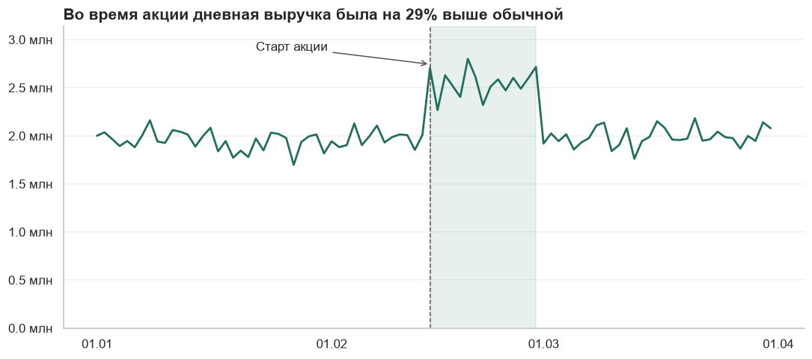
<!-- /result -->


Число в заголовке вычисляется из данных, а не вписано руками: при обновлении данных заголовок останется верным.

### Задание 3. Один график или малые кратные

```python
categories = ["Книги", "Техника", "Одежда", "Обувь", "Игрушки", "Спорт", "Дом", "Красота"]
x = np.arange(1, 13)
data = {name: 100 + rng.normal(rng.uniform(-1, 5), 5, 12).cumsum() for name in categories}

growth = {name: values[-1] / values[0] - 1 for name, values in data.items()}
leader = max(growth, key=growth.get)

# Способ 1: акцент на лидере
fig, ax = plt.subplots(figsize=(9, 4.5))
for name, values in data.items():
    main = name == leader
    ax.plot(x, values, color=ACCENT if main else MUTED, linewidth=2.6 if main else 1.2, zorder=3 if main else 1)
ax.text(12.15, data[leader][-1], leader, color=ACCENT, fontweight="bold", va="center")
ax.set_xlim(1, 13.4)
ax.set_title(f"«{leader}» — самая быстрорастущая категория: {growth[leader]:+.0%} за год", loc="left", fontweight="bold")
fig.tight_layout()
plt.show()

# Способ 2: малые кратные
fig, axes = plt.subplots(2, 4, figsize=(12, 5), sharex=True, sharey=True)
for ax, (name, values) in zip(axes.flat, sorted(data.items(), key=lambda item: -growth[item[0]])):
    ax.plot(x, values, color=ACCENT if growth[name] >= 0 else WARNING, linewidth=2)
    ax.set_title(f"{name}: {growth[name]:+.0%}", fontsize=10.5)
fig.tight_layout()
plt.show()
```

<!-- result -->
*Результат:*

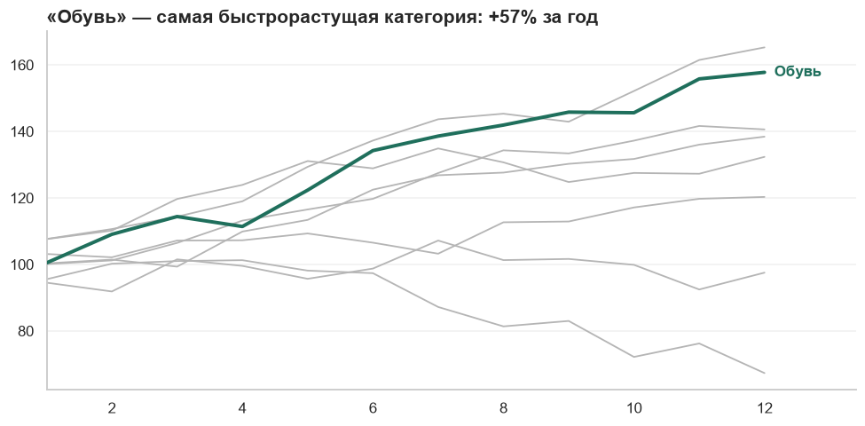

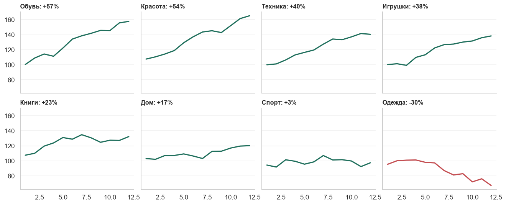
<!-- /result -->


Первый способ отвечает на вопрос «кто лидер»: одна мысль, один акцент. Второй — на вопрос «как ведёт себя каждая»: панели отсортированы по росту, у всех общая шкала.

Выбор зависит от того, что нужно сказать. Попытка ответить на оба вопроса одним графиком с восемью цветными линиями не отвечает ни на один.

### Задание 4. Каскадная диаграмма

```python
def waterfall(ax, start_label, start_value, changes, end_label):
    """changes — список пар (название, изменение)."""
    labels = [start_label] + [name for name, _ in changes] + [end_label]
    level = start_value
    bottoms, heights, colors, texts = [0], [start_value], ["#555555"], [f"{start_value:,.0f}"]
    for _, delta in changes:
        bottoms.append(level if delta >= 0 else level + delta)
        heights.append(abs(delta))
        colors.append(ACCENT if delta >= 0 else WARNING)
        texts.append(f"{delta:+,.0f}")
        level += delta
    bottoms.append(0)
    heights.append(level)
    colors.append("#555555")
    texts.append(f"{level:,.0f}")

    bars = ax.bar(labels, heights, bottom=bottoms, color=colors, width=0.6)
    for bar, text in zip(bars, texts):
        ax.text(bar.get_x() + bar.get_width() / 2, bar.get_y() + bar.get_height(), text,
                ha="center", va="bottom", fontsize=10)
    return level


fig, ax = plt.subplots(figsize=(8.5, 4.5))
end = waterfall(ax, "Начало\nмесяца", 10_000, [("Новые", 2400), ("Вернулись", 600), ("Ушли", -1900)], "Конец\nмесяца")
ax.set_ylim(0, 14_500)
ax.set_title(f"Аудитория выросла до {end:,.0f}: приток перекрыл отток".replace(",", " "), loc="left", fontweight="bold")
fig.tight_layout()
plt.show()
```

<!-- result -->
*Результат:*

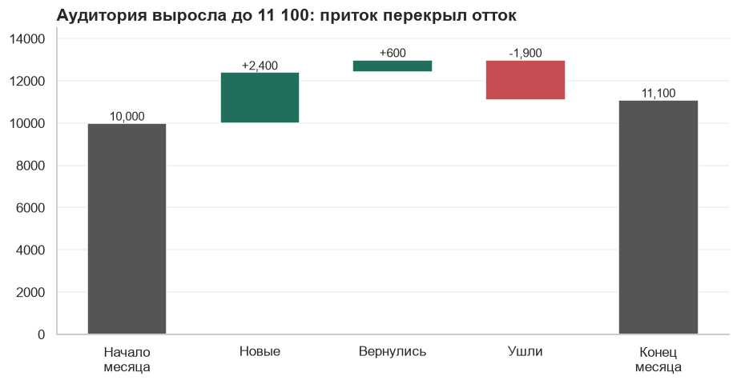
<!-- /result -->


Логика вынесена в функцию — её можно использовать для любой метрики. Проверка расчёта: 10 000 + 2 400 + 600 − 1 900 = 11 100.

### Задание 5. Две ECDF

```python
group_a = rng.lognormal(7.6, 0.8, 4000)
group_b = rng.lognormal(7.6, 0.8, 4000)
threshold = np.quantile(group_b, 0.9)
group_b = np.where(group_b > threshold, group_b * 1.6, group_b)     # в группе B крупные чеки стали ещё крупнее


def plot_ecdf(ax, values, **kwargs):
    ordered = np.sort(values)
    ax.plot(ordered, np.arange(1, len(ordered) + 1) / len(ordered), **kwargs)


fig, ax = plt.subplots(figsize=(8.5, 4.5))
plot_ecdf(ax, group_a, color=MUTED, linewidth=2.2, label=f"A: среднее {group_a.mean():,.0f}, медиана {np.median(group_a):,.0f}")
plot_ecdf(ax, group_b, color=ACCENT, linewidth=2.2, label=f"B: среднее {group_b.mean():,.0f}, медиана {np.median(group_b):,.0f}")
ax.set_xscale("log")
ax.yaxis.set_major_formatter(PercentFormatter(xmax=1))
ax.set_xlabel("Сумма чека, руб. (логарифмическая шкала)")
ax.legend(loc="lower right")
ax.set_title("Группы различаются только в верхних 10 % чеков", loc="left", fontweight="bold")
fig.tight_layout()
plt.show()
```

<!-- result -->
*Результат:*

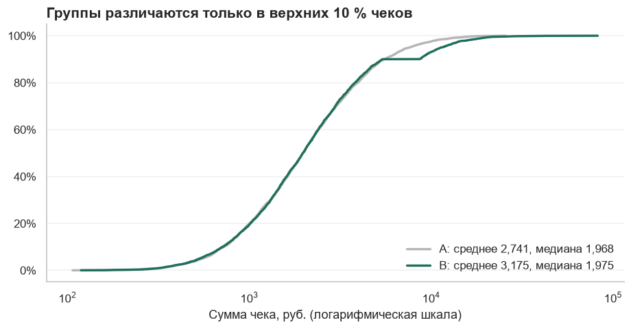
<!-- /result -->


Среднее в группе B заметно выше, медианы почти равны. Средние говорят «B лучше», но не говорят как. По ECDF видно: до 90-го перцентиля кривые совпадают, а расходятся только в верхней части. Значит, изменение не повлияло на обычных покупателей — эффект дали крупные чеки небольшой группы. Это меняет и вывод, и то, как проверять результат: с такой метрикой нужен тест, устойчивый к хвосту (глава 9А).

### Задание 6. Формулы показателей

В нотации DataLens и Tableau они записываются почти одинаково:

```
Конверсия визит → заказ    COUNTD([order_id]) / COUNTD([visit_id])

Доля категории в выручке   SUM([amount]) / SUM([amount] TOTAL)            -- DataLens
                           SUM([Amount]) / TOTAL(SUM([Amount]))            -- Tableau

Выручка на клиента         SUM([amount]) / COUNTD([user_id])

Доля крупных заказов       COUNTD(IF [amount] >= 5000 THEN [order_id] END) / COUNTD([order_id])
```

Общий принцип: числитель и знаменатель агрегируются по отдельности. В последней формуле использована условная агрегация — та же, что `COUNT(DISTINCT CASE WHEN ...)` в SQL: `IF` без `ELSE` даёт пустое значение, которое не считается.

Оговорка к первой формуле: она верна, только если визиты и заказы лежат в одной таблице или корректно связаны. Если у визита может быть несколько заказов и таблицы соединены, проверь, что число визитов не размножилось.

### Задание 7. Найди ошибку

**«Покупатели» как сумма по городам.** Уникальные пользователи — неаддитивный показатель. Человек, покупавший и в Москве, и в Казани, посчитан дважды, и итог завышен. Правильно: `COUNTD([user_id])` по всем данным. Итог может быть **меньше** суммы строк, и это нормально.

**«Средний чек» как среднее по городам.** Это среднее средних: город с десятью заказами весит столько же, сколько город с десятью тысячами. Правильно: общая выручка, делённая на общее число заказов.

Обе ошибки возникают, когда итог вычисляется из уже посчитанных строк таблицы, а не из исходных данных. В настройках итогов в BI-инструментах обычно есть выбор: «сумма», «среднее» или «вычислить по формуле показателя». Нужен последний вариант.

### Задание 8. Дашборд для службы доставки

Образец ответа.

**Пять вопросов:**

1. Кто: руководитель службы доставки.
2. Какое решение: куда направить курьеров, с какими партнёрами разбираться, где менять зоны и интервалы.
3. Как часто: каждое утро и несколько раз в течение дня.
4. Что понять за 10 секунд: укладываемся ли мы в обещанные сроки сегодня.
5. Что сделает при плохом числе: откроет разрез по районам и партнёрам, свяжется с проблемным.

Частота «несколько раз в день» означает, что дашборд **операционный**: свежие данные важнее глубокой аналитики.

**Четыре KPI:**

| Показатель | Определение | Сравнение |
|------------|-------------|-----------|
| Доля доставок в срок | Доставлено в обещанный интервал / все доставленные | С целью 95 % и со вчера |
| Медианное время доставки | От оформления до вручения | С тем же днём прошлой недели |
| Доля неудачных доставок | Отмены и возвраты по вине доставки / все отправления | С прошлой неделей |
| Заказов в работе сейчас | Принятые, но не вручённые | С мощностью службы |

Время доставки — медиана, а не среднее: несколько потерянных заказов исказили бы картину. Рядом стоит показать и 90-й перцентиль — «как долго ждут невезучие».

**Макет:**

```
┌───────────────────────────────────────────────────────────────┐
│ Доставка · сегодня · обновлено 10:42      [Город] [Партнёр]   │
├──────────────┬──────────────┬───────────────┬─────────────────┤
│ В срок       │ Время        │ Неудачные     │ В работе        │
│ 93,1 %       │ 47 мин       │ 2,4 %         │ 318             │
│ цель 95 % ▼  │ ▲ 4 мин      │ ▼ 0,3 п. п.   │ из 400          │
├──────────────┴──────────────┴───────────────┴─────────────────┤
│ Доля доставок в срок по часам: сегодня против прошлой недели  │
├───────────────────────────────┬───────────────────────────────┤
│ В срок по районам (столбцы,   │ В срок по партнёрам           │
│ худшие сверху)                │ (столбцы, худшие сверху)      │
├───────────────────────────────┴───────────────────────────────┤
│ Заказы с опозданием больше 30 минут: список для разбора       │
└───────────────────────────────────────────────────────────────┘
```

Разрезы отсортированы «худшие сверху» — руководителю нужны проблемы, а не лидеры. Нижняя таблица превращает дашборд из «посмотреть» в «сделать»: это список конкретных заказов, с которыми нужно разобраться.
