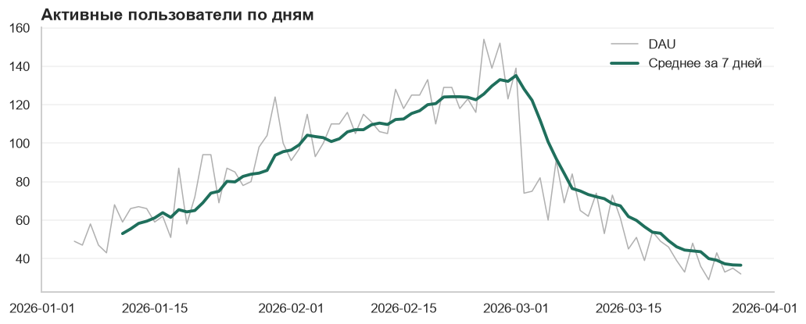
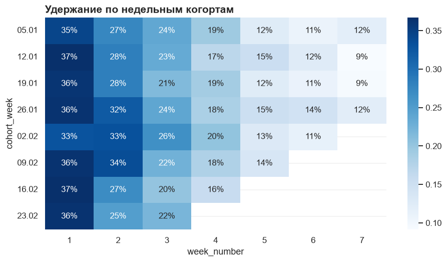
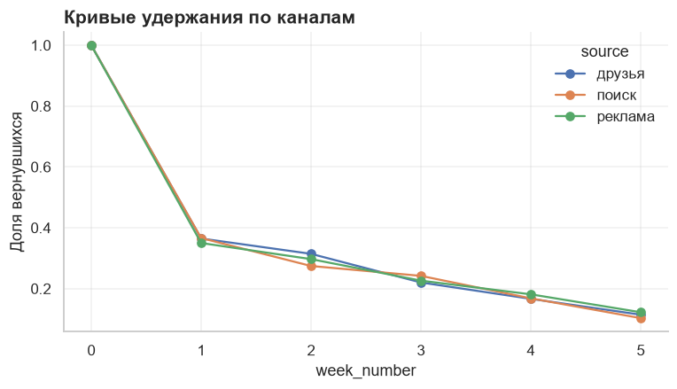

# Глава 10. Продуктовая аналитика

Предыдущие главы были про инструменты. Эта — про то, **что именно** считают аналитики в компаниях: метрики, воронки, когорты, удержание, юнит-экономику. Большинство учебных проектов Яндекс Практикума и karpov.courses, на которые мы ссылаемся, — именно про это.

## 10.1. Данные для главы: лог событий

Продуктовые данные обычно хранятся как лог событий: одна строка — одно действие пользователя.

```python
import numpy as np
import pandas as pd

rng = np.random.default_rng(42)
n_users = 3000

users = pd.DataFrame({
    "user_id": np.arange(1, n_users + 1),
    "first_date": pd.Timestamp("2026-01-05") + pd.to_timedelta(rng.integers(0, 56, n_users), unit="D"),
    "source": rng.choice(["реклама", "поиск", "друзья"], n_users, p=[0.5, 0.3, 0.2]),
})

steps = ["visit", "view_item", "add_to_cart", "purchase"]
pass_prob = [1.0, 0.55, 0.35, 0.45]      # вероятность дойти до шага с предыдущего

rows = []
for user in users.itertuples():
    for week in range(8):
        # вероятность вернуться падает с каждой неделей
        if week > 0 and rng.random() > 0.45 * 0.8 ** week:
            continue
        offset = 0 if week == 0 else 7 * week + int(rng.integers(0, 7))
        day = user.first_date + pd.Timedelta(days=offset)
        for step, prob in zip(steps, pass_prob):
            if rng.random() > prob:
                break
            amount = round(float(rng.gamma(2.0, 1500)), 0) if step == "purchase" else np.nan
            rows.append((user.user_id, day, step, amount))

events = pd.DataFrame(rows, columns=["user_id", "date", "event", "amount"])
events = events[events["date"] <= "2026-03-29"]
events = events.merge(users, on="user_id", validate="many_to_one")
events.to_csv("events.csv", index=False)
print(events.shape)
print(events.head())
```

<!-- result -->
*Результат:*

```output
(12738, 6)
   user_id       date      event  amount first_date  source
0        1 2026-01-09      visit     NaN 2026-01-09   поиск
1        1 2026-01-09  view_item     NaN 2026-01-09   поиск
2        1 2026-01-26      visit     NaN 2026-01-09   поиск
3        1 2026-01-26  view_item     NaN 2026-01-09   поиск
4        2 2026-02-17      visit     NaN 2026-02-17  друзья
```
<!-- /result -->


Здесь цикл по пользователям уместен: мы не анализируем данные, а генерируем их.

## 10.2. Метрики

Метрика — число, которое показывает, как дела у продукта.

### Аудитория

- **DAU / WAU / MAU** — число уникальных активных пользователей за день / неделю / месяц.
- **Sticky factor** = DAU / MAU — как часто пользователи возвращаются. 20 % означает, что средний пользователь заходит около 6 дней в месяц.

```python
dau = events.groupby("date")["user_id"].nunique()
wau = events.groupby(events["date"].dt.to_period("W"))["user_id"].nunique()
mau = events.groupby(events["date"].dt.to_period("M"))["user_id"].nunique()

print(dau.tail(3))
print(mau)
print("Sticky factor:", round(dau.mean() / mau.mean(), 3))
```

<!-- result -->
*Результат:*

```output
date
2026-03-27    33
2026-03-28    35
2026-03-29    32
Name: user_id, dtype: int64
date
2026-01    1461
2026-02    2358
2026-03    1268
Freq: M, Name: user_id, dtype: int64
Sticky factor: 0.049
```
<!-- /result -->


Важно: MAU — это не сумма DAU. Один и тот же человек в сумме посчитается много раз. Уникальных пользователей всегда считают через `nunique()` / `COUNT(DISTINCT ...)` за нужный период.

### Деньги

| Метрика | Формула | Смысл |
|---------|---------|-------|
| Выручка (Revenue) | сумма покупок | — |
| Средний чек (AOV) | выручка / число заказов | Сколько тратят за раз |
| ARPU | выручка / число всех пользователей | Сколько приносит один пользователь |
| ARPPU | выручка / число платящих | Сколько приносит один платящий |
| Конверсия (CR) | число купивших / число пришедших | Какая доля покупает |

```python
purchases = events[events["event"] == "purchase"]

revenue = purchases["amount"].sum()
orders = len(purchases)
all_users = events["user_id"].nunique()
paying_users = purchases["user_id"].nunique()

print("Выручка:", round(revenue))
print("Средний чек:", round(revenue / orders))
print("ARPU:", round(revenue / all_users))
print("ARPPU:", round(revenue / paying_users))
print("Конверсия в покупку:", round(paying_users / all_users, 3))
```

<!-- result -->
*Результат:*

```output
Выручка: 1767014
Средний чек: 2975
ARPU: 589
ARPPU: 3161
Конверсия в покупку: 0.186
```
<!-- /result -->


Метрики связаны: `ARPU = конверсия × ARPPU`. Такое разложение — главный приём диагностики: если упал ARPU, смотрим, какой из множителей просел.

### Хорошая метрика

- понятна без объяснений;
- чувствительна к изменениям в продукте;
- её трудно накрутить без пользы для дела;
- является **отношением**, а не абсолютным числом — когда это возможно («конверсия» информативнее, чем «число покупок»).

## 10.3. Воронка

Воронка показывает, сколько пользователей доходит до каждого шага и где они теряются.

```python
funnel = (
    events.groupby("event")["user_id"].nunique()
          .reindex(steps)
          .to_frame("users")
)
funnel["from_first"] = funnel["users"] / funnel["users"].iloc[0]
funnel["from_prev"] = funnel["users"] / funnel["users"].shift(1)
print(funnel.round(3))
```

<!-- result -->
*Результат:*

```output
             users  from_first  from_prev
event                                    
visit         3000       1.000        NaN
view_item     2382       0.794      0.794
add_to_cart   1155       0.385      0.485
purchase       559       0.186      0.484
```
<!-- /result -->


- `from_first` — конверсия от первого шага: какая доля всех пришедших дошла сюда;
- `from_prev` — конверсия от предыдущего шага: она показывает **самое узкое место**.

Воронка в разрезе — стандартный способ искать причину проблемы:

```python
by_source = (
    events.pivot_table(index="source", columns="event", values="user_id", aggfunc="nunique")[steps]
)
by_source["cr_to_purchase"] = by_source["purchase"] / by_source["visit"]
print(by_source.round(3))
```

<!-- result -->
*Результат:*

```output
event    visit  view_item  add_to_cart  purchase  cr_to_purchase
source                                                          
друзья     595        473          239       103           0.173
поиск      893        708          332       170           0.190
реклама   1512       1201          584       286           0.189
```
<!-- /result -->


Тонкость: мы считаем уникальных пользователей, которые совершили событие хотя бы раз за период. Строгая воронка требует ещё и правильного порядка событий во времени — в реальных данных пользователь может попасть на страницу оплаты, минуя корзину.

## 10.4. Когортный анализ и удержание

**Когорта** — группа пользователей, объединённых общим событием в один период. Чаще всего — неделей или месяцем первого визита.

**Удержание (retention)** — доля пользователей когорты, которые вернулись через N периодов.

Зачем нужны когорты: общая метрика смешивает новых и старых пользователей. Если реклама привела много новичков, DAU растёт — даже если продукт стал хуже и все быстро уходят. Когорты показывают, что происходит на самом деле.

```python
events["cohort_week"] = events["first_date"].dt.to_period("W").dt.start_time       # когорта: неделя прихода
events["week_number"] = (events["date"] - events["first_date"]).dt.days // 7       # неделя жизни пользователя

cohorts = events.pivot_table(
    index="cohort_week",
    columns="week_number",
    values="user_id",
    aggfunc="nunique",
)
retention = cohorts.div(cohorts[0], axis=0)

# Недели, которые когорта ещё не прожила целиком, показывать нельзя: там неполные данные
last_date = events["date"].max()
for week in retention.columns:
    week_end = retention.index + pd.Timedelta(days=7 * (week + 1) + 5)    # конец недели у самых поздних в когорте
    retention.loc[week_end > last_date, week] = np.nan

print(retention.round(2))
```

<!-- result -->
*Результат:*

```output
week_number    0     1     2     3     4     5     6     7
cohort_week                                               
2026-01-05   1.0  0.35  0.27  0.24  0.19  0.12  0.11  0.12
2026-01-12   1.0  0.37  0.28  0.23  0.17  0.15  0.12  0.09
2026-01-19   1.0  0.36  0.28  0.21  0.19  0.12  0.11  0.09
2026-01-26   1.0  0.36  0.32  0.24  0.18  0.15  0.14  0.12
2026-02-02   1.0  0.33  0.33  0.26  0.20  0.13  0.11   NaN
2026-02-09   1.0  0.36  0.34  0.22  0.18  0.14   NaN   NaN
2026-02-16   1.0  0.37  0.27  0.20  0.16   NaN   NaN   NaN
2026-02-23   1.0  0.36  0.25  0.22   NaN   NaN   NaN   NaN
```
<!-- /result -->


Два столбца — две разные вещи:

- `cohort_week` — календарная неделя, в которую пользователь пришёл. По ней пользователи объединяются в когорты.
- `week_number` — номер недели **жизни** пользователя, отсчитанный от его собственного первого дня: дни 0–6 — нулевая неделя, дни 7–13 — первая и так далее. Так все пользователи когорты сравниваются в одинаковом «возрасте».

Последний шаг — маскирование неполных недель — пропускают чаще всего. Без него в правой нижней части таблицы стояли бы заниженные числа: когорта ещё не успела прожить эту неделю целиком, и «низкое удержание» было бы просто нехваткой данных.

Как читать таблицу:

- **строка** — одна когорта; движение вправо — её «жизнь» по неделям;
- **столбец** — одна и та же неделя жизни у разных когорт: сравнение по вертикали показывает, стал ли продукт лучше удерживать;
- в столбце 0 всегда 100 %;
- правый нижний угол пустой — эти недели ещё не наступили.

Тепловая карта — стандартный способ показать удержание:

```python
import matplotlib.pyplot as plt
import seaborn as sns

fig, ax = plt.subplots(figsize=(10, 5))
sns.heatmap(retention.iloc[:, 1:], annot=True, fmt=".0%", cmap="Blues", ax=ax)
ax.set_yticklabels([d.strftime("%d.%m") for d in retention.index], rotation=0)
ax.set_title("Удержание по недельным когортам")
ax.set_xlabel("Неделя жизни")
ax.set_ylabel("Когорта (неделя первого визита)")
plt.show()
```

<!-- result -->
*Результат:*


<!-- /result -->


**Отток (churn)** — обратная сторона удержания: доля ушедших. `churn = 1 − retention`.

Форма кривой удержания важнее отдельных чисел. Если кривая со временем выходит на плато — у продукта есть ядро постоянных пользователей. Если падает к нулю — продукт «дырявое ведро», и привлечение новых пользователей его не спасёт.

## 10.5. LTV и юнит-экономика

- **LTV (Lifetime Value)** — сколько денег в среднем приносит один пользователь за всё время.
- **CAC (Customer Acquisition Cost)** — сколько стоит привлечь одного пользователя.
- **ROMI** — окупаемость маркетинга: `(доход − расходы) / расходы`.

Бизнес сходится, когда `LTV > CAC`. Обычно ориентир — LTV хотя бы в три раза больше CAC.

Накопительный LTV по когортам считается так же, как удержание, только вместо числа пользователей — выручка:

```python
cohort_size = events.groupby("cohort_week")["user_id"].nunique()

purchases = events[events["event"] == "purchase"]    # заново: в events появились столбцы когорт
revenue_by_week = purchases.pivot_table(
    index="cohort_week", columns="week_number", values="amount", aggfunc="sum"
)

ltv = revenue_by_week.cumsum(axis=1).div(cohort_size, axis=0)
print(ltv.round(0))
```

<!-- result -->
*Результат:*

```output
week_number      0      1      2      3      4      5      6      7
cohort_week                                                        
2026-01-05   254.0  402.0  457.0  485.0  496.0  533.0  552.0  585.0
2026-01-12   252.0  323.0  344.0  364.0  389.0  416.0  436.0  441.0
2026-01-19   318.0  417.0  492.0  508.0  600.0  616.0  650.0  685.0
2026-01-26   205.0  370.0  482.0  530.0  548.0  590.0  639.0  668.0
2026-02-02   239.0  336.0  383.0  463.0  511.0  548.0  577.0  592.0
2026-02-09   326.0  403.0  470.0  521.0  581.0  618.0  635.0    NaN
2026-02-16   206.0  323.0  402.0  439.0  473.0  484.0    NaN    NaN
2026-02-23   300.0  386.0  505.0  609.0  629.0    NaN    NaN    NaN
```
<!-- /result -->


Сравнение каналов привлечения:

```python
cac = pd.Series({"реклама": 900, "поиск": 400, "друзья": 150})    # условные расходы на пользователя

by_source = events.groupby("source").agg(users=("user_id", "nunique"))
by_source["revenue"] = purchases.groupby("source")["amount"].sum()
by_source["ltv"] = by_source["revenue"] / by_source["users"]
by_source["cac"] = cac
by_source["ltv_to_cac"] = by_source["ltv"] / by_source["cac"]
print(by_source.round(2))
```

<!-- result -->
*Результат:*

```output
         users   revenue     ltv  cac  ltv_to_cac
source                                           
друзья     595  307429.0  516.69  150        3.44
поиск      893  548073.0  613.74  400        1.53
реклама   1512  911512.0  602.85  900        0.67
```
<!-- /result -->


## 10.6. RFM-сегментация

Простой способ разделить клиентов на группы по трём признакам:

- **Recency** — как давно была последняя покупка;
- **Frequency** — как часто покупает;
- **Monetary** — сколько потратил.

```python
today = purchases["date"].max() + pd.Timedelta(days=1)

rfm = purchases.groupby("user_id").agg(
    recency=("date", lambda d: (today - d.max()).days),
    frequency=("date", "count"),
    monetary=("amount", "sum"),
)

rfm["r"] = pd.qcut(rfm["recency"], 3, labels=[3, 2, 1]).astype(int)       # недавно = 3
rfm["f"] = pd.cut(rfm["frequency"], bins=[0, 1, 2, np.inf], labels=[1, 2, 3]).astype(int)
rfm["m"] = pd.qcut(rfm["monetary"], 3, labels=[1, 2, 3]).astype(int)
rfm["segment"] = rfm["r"].astype(str) + rfm["f"].astype(str) + rfm["m"].astype(str)

print(rfm["segment"].value_counts().head())
```

<!-- result -->
*Результат:*

```output
segment
311    67
112    63
111    63
212    62
113    57
Name: count, dtype: int64
```
<!-- /result -->


Сегмент `333` — лучшие клиенты: покупали недавно, часто и много. Сегмент `133` — покупали часто и много, но давно: их нужно возвращать в первую очередь.

## 10.7. Как искать причину изменения метрики

Самая частая задача на работе и на собеседовании: «Вчера упала выручка. Что будешь делать?»

1. **Проверь данные.** Не сломался ли сбор событий, не изменился ли способ расчёта, полные ли данные за день. Очень часто причина здесь.
2. **Посмотри на масштаб и время.** Резко или постепенно? Было ли так же год назад (сезонность)? Праздник, выходной?
3. **Разложи метрику.** Выручка = пользователи × конверсия × средний чек. Какой множитель просел?
4. **Разрежь по сегментам.** Платформа, версия приложения, страна, канал привлечения, новые и старые пользователи. Упало везде или в одном месте?
5. **Пройди по воронке.** На каком шаге стали теряться пользователи?
6. **Сопоставь с событиями.** Релиз, изменение цен, рекламная кампания, сбой, действия конкурентов.
7. **Сформулируй гипотезу и проверь её** на данных.

Отвечая на собеседовании, проговаривай именно эту структуру — её и хотят услышать.

## Практика на GitHub

Эта глава — мост к готовым проектам. Открывай их и разбирай: какой был вопрос, какие метрики считали, какой сделали вывод.

- [Yourius/Projects_Ya](https://github.com/Yourius/Projects_Ya) — воронка событий мобильного приложения, расчёт маркетинговых метрик (LTV, CAC, ROMI, удержание).
- [DataAna1ytics/Projects_Data_Analytics](https://github.com/DataAna1ytics/Projects_Data_Analytics) — проекты курсов «Аналитик данных» и «Симулятор аналитика»: продуктовые метрики на практике.
- [GonorAndres/data-analyst-path](https://github.com/GonorAndres/data-analyst-path) — когортный анализ e-commerce и KPI-отчёт.
- [Lenupcik/portfolio](https://github.com/Lenupcik/portfolio) — исследование аудитории и дашборд с метриками.
- [DataTalksClub](https://github.com/DataTalksClub) — бесплатные курсы с домашними заданиями; пригодятся, когда захочешь углубиться в инженерию данных.

## Задания

На `events.csv`:

1. Посчитай DAU, WAU и sticky factor. Построй график DAU со скользящим средним.
2. Построй воронку отдельно для каждого канала привлечения. Где самое узкое место?
3. Построй таблицу удержания по недельным когортам и тепловую карту. Отличается ли удержание у разных каналов?
4. Посчитай ARPU и ARPPU по месяцам.
5. Посчитай накопительный LTV по каналам и сравни с условным CAC из раздела 10.5. Какой канал выгоднее?
6. Сделай RFM-сегментацию. Какую долю выручки приносят лучшие 20 % клиентов?
7. Письменно ответь на вопрос: «Конверсия в покупку упала на 15 % за неделю. Твои действия?»

## Проверь себя

- Почему MAU нельзя получить сложением DAU?
- Чем ARPU отличается от ARPPU?
- Что такое когорта и зачем нужен когортный анализ?
- Как читать таблицу удержания по строкам и по столбцам?
- Что означает `LTV > CAC`?
- С чего начинать поиск причины падения метрики?

## Решения

Общая подготовка:

```python
import numpy as np
import pandas as pd
import matplotlib.pyplot as plt
import seaborn as sns

events = pd.read_csv("events.csv", parse_dates=["date", "first_date"])
purchases = events[events["event"] == "purchase"]
STEPS = ["visit", "view_item", "add_to_cart", "purchase"]
```

### Задание 1. DAU, WAU, sticky factor

```python
dau = events.groupby("date")["user_id"].nunique()
wau = events.groupby(events["date"].dt.to_period("W"))["user_id"].nunique()
mau = events.groupby(events["date"].dt.to_period("M"))["user_id"].nunique()

sticky = dau.groupby(dau.index.to_period("M")).mean() / mau
print(sticky.round(3))

fig, ax = plt.subplots(figsize=(11, 4))
ax.plot(dau.index, dau.values, color="#b0b0b0", linewidth=1, label="DAU")
ax.plot(dau.index, dau.rolling(7).mean(), color="#1f6f5c", linewidth=2.5, label="Среднее за 7 дней")
ax.set_title("Активные пользователи по дням")
ax.legend()
plt.show()
```

<!-- result -->
*Результат:*

```output
date
2026-01    0.050
2026-02    0.050
2026-03    0.046
Freq: M, Name: user_id, dtype: float64
```


<!-- /result -->


Sticky factor посчитан отдельно для каждого месяца: средний DAU месяца делится на MAU этого же месяца. Это точнее, чем делить общее среднее на общее среднее, как в разделе 10.2.

На графике DAU сначала растёт, потом падает. Это не «проблема продукта», а свойство наших данных: новые пользователи приходили только первые восемь недель. Прежде чем объяснять динамику поведением, проверь, как менялся приток новых пользователей.

### Задание 2. Воронка по каналам

```python
funnel = events.pivot_table(index="source", columns="event", values="user_id", aggfunc="nunique")[STEPS]

step_conversion = funnel.div(funnel.shift(axis=1)).drop(columns="visit")
step_conversion["visit → purchase"] = funnel["purchase"] / funnel["visit"]

print(funnel)
print(step_conversion.round(3))
print("Узкое место по каналам:")
print(step_conversion[STEPS[1:]].idxmin(axis=1))
```

<!-- result -->
*Результат:*

```output
event    visit  view_item  add_to_cart  purchase
source                                          
друзья     595        473          239       103
поиск      893        708          332       170
реклама   1512       1201          584       286
event    view_item  add_to_cart  purchase  visit → purchase
source                                                     
друзья       0.795        0.505     0.431             0.173
поиск        0.793        0.469     0.512             0.190
реклама      0.794        0.486     0.490             0.189
Узкое место по каналам:
source
друзья        purchase
поиск      add_to_cart
реклама    add_to_cart
dtype: str
```
<!-- /result -->


`funnel.shift(axis=1)` сдвигает столбцы вправо, поэтому деление даёт конверсию каждого шага от предыдущего.

Переходы «товар → корзина» и «корзина → оплата» теряют примерно поровну — около половины пользователей каждый. Поэтому «узким местом» в одном канале оказывается один шаг, в другом — другой: разница между ними случайна, вероятности в генераторе одинаковы для всех каналов. Если бы это были настоящие данные, для вывода «канал X хуже» потребовалась бы проверка значимости из главы 9.

### Задание 3. Удержание по когортам и каналам

```python
events["cohort_week"] = events["first_date"].dt.to_period("W").dt.start_time
events["week_number"] = (events["date"] - events["first_date"]).dt.days // 7


def retention_table(data: pd.DataFrame, by: str) -> pd.DataFrame:
    """Доля пользователей группы, активных на каждой неделе жизни."""
    counts = data.pivot_table(index=by, columns="week_number", values="user_id", aggfunc="nunique")
    return counts.div(counts[0], axis=0)


by_cohort = retention_table(events, "cohort_week")

last_date = events["date"].max()                     # скрыть недели, которые когорта ещё не прожила
for week in by_cohort.columns:
    week_end = by_cohort.index + pd.Timedelta(days=7 * (week + 1) + 5)
    by_cohort.loc[week_end > last_date, week] = np.nan

fig, ax = plt.subplots(figsize=(10, 5))
sns.heatmap(by_cohort.iloc[:, 1:], annot=True, fmt=".0%", cmap="Blues", ax=ax)
ax.set_yticklabels([d.strftime("%d.%m") for d in by_cohort.index], rotation=0)
ax.set_title("Удержание по недельным когортам")
plt.show()

by_source = retention_table(events, "source")
print(by_source.iloc[:, :6].round(3))

by_source.iloc[:, :6].T.plot(marker="o", figsize=(8, 4), title="Кривые удержания по каналам")
plt.ylabel("Доля вернувшихся")
plt.show()
```

<!-- result -->
*Результат:*

```output
week_number    0      1      2      3      4      5
source                                             
друзья       1.0  0.365  0.314  0.220  0.166  0.114
поиск        1.0  0.366  0.274  0.242  0.168  0.103
реклама      1.0  0.350  0.297  0.226  0.181  0.122
```




<!-- /result -->


Функция `retention_table` принимает столбец группировки параметром, поэтому одна и та же логика работает и для когорт, и для каналов — пример принципа DRY из главы 2В.

Сравнивая каналы, бери только те недели жизни, которые успели прожить **все** пользователи (здесь — первые несколько). На поздних неделях данных мало, и последние когорты до них ещё не дожили.

### Задание 4. ARPU и ARPPU по месяцам

```python
events["month"] = events["date"].dt.to_period("M")
purchases = events[events["event"] == "purchase"]

monthly = pd.DataFrame({
    "active_users": events.groupby("month")["user_id"].nunique(),
    "paying_users": purchases.groupby("month")["user_id"].nunique(),
    "revenue": purchases.groupby("month")["amount"].sum(),
})
monthly["arpu"] = monthly["revenue"] / monthly["active_users"]
monthly["arppu"] = monthly["revenue"] / monthly["paying_users"]
monthly["paying_share"] = monthly["paying_users"] / monthly["active_users"]

print(monthly.round(2))
```

<!-- result -->
*Результат:*

```output
         active_users  paying_users   revenue    arpu    arppu  paying_share
month                                                                       
2026-01          1461           167  490862.0  335.98  2939.29          0.11
2026-02          2358           264  825097.0  349.91  3125.37          0.11
2026-03          1268           144  451055.0  355.72  3132.33          0.11
```
<!-- /result -->


Самопроверка: `arpu` должен равняться `arppu × paying_share`. Добавь `assert np.allclose(monthly["arpu"], monthly["arppu"] * monthly["paying_share"])` — если разложение не сходится, в расчёте ошибка.

### Задание 5. LTV по каналам против CAC

```python
CAC = pd.Series({"реклама": 900, "поиск": 400, "друзья": 150})    # условные расходы на пользователя
MAX_WEEK = 4          # сравниваем на горизонте, который прожили все когорты

users_by_source = events.groupby("source")["user_id"].nunique()

revenue = (
    purchases[purchases["week_number"] <= MAX_WEEK]
    .pivot_table(index="source", columns="week_number", values="amount", aggfunc="sum", fill_value=0)
)
ltv = revenue.cumsum(axis=1).div(users_by_source, axis=0)

result = pd.DataFrame({
    f"LTV за {MAX_WEEK + 1} недель": ltv.iloc[:, -1],
    "CAC": CAC,
})
result["LTV / CAC"] = result.iloc[:, 0] / result["CAC"]
print(ltv.round(0))
print(result.round(2))
```

<!-- result -->
*Результат:*

```output
week_number      0      1      2      3      4
source                                        
друзья       258.0  351.0  394.0  437.0  448.0
поиск        258.0  366.0  444.0  486.0  556.0
реклама      265.0  379.0  459.0  512.0  542.0
         LTV за 5 недель  CAC  LTV / CAC
друзья            447.98  150       2.99
поиск             555.66  400       1.39
реклама           542.36  900       0.60
```
<!-- /result -->


Перед этим расчётом нужно выполнить код задания 3: он добавляет столбец `week_number`.

LTV у каналов близок (поведение пользователей в генераторе одинаковое), а стоимость привлечения различается в шесть раз. Поэтому самый выгодный канал — «друзья», а реклама окупается хуже всех. Типичный вывод из реальной практики: канал, дающий больше всего пользователей, не обязательно самый выгодный.

Оговорка, которую стоит писать в отчёте: это LTV за пять недель, а не за всю жизнь пользователя. Настоящий LTV выше, поэтому отношение `LTV / CAC` здесь — оценка снизу.

### Задание 6. RFM и доля выручки лучших клиентов

```python
today = purchases["date"].max() + pd.Timedelta(days=1)

rfm = purchases.groupby("user_id").agg(
    recency=("date", lambda d: (today - d.max()).days),
    frequency=("date", "count"),
    monetary=("amount", "sum"),
)
rfm["r"] = pd.qcut(rfm["recency"], 3, labels=[3, 2, 1]).astype(int)
rfm["f"] = pd.cut(rfm["frequency"], bins=[0, 1, 2, np.inf], labels=[1, 2, 3]).astype(int)
rfm["m"] = pd.qcut(rfm["monetary"], 3, labels=[1, 2, 3]).astype(int)
rfm["segment"] = rfm["r"].astype(str) + rfm["f"].astype(str) + rfm["m"].astype(str)

print(rfm.groupby("segment").agg(users=("monetary", "count"), revenue=("monetary", "sum"))
         .sort_values("revenue", ascending=False).head(8))

top_20 = rfm["monetary"].nlargest(int(len(rfm) * 0.2)).sum()
print(f"Лучшие 20 % клиентов приносят {top_20 / rfm['monetary'].sum():.1%} выручки")
```

<!-- result -->
*Результат:*

```output
         users   revenue
segment                 
213         54  316447.0
113         57  306879.0
313         51  285925.0
112         63  166947.0
212         62  159720.0
312         51  134529.0
323         12   88883.0
311         67   73471.0
Лучшие 20 % клиентов приносят 43.6% выручки
```
<!-- /result -->


Для `recency` метки идут в обратном порядке (`[3, 2, 1]`): чем меньше дней прошло, тем лучше. Для `frequency` использован `pd.cut` с явными границами, а не `qcut`: у большинства клиентов одна покупка, и разбить такой столбец на равные по размеру группы невозможно.

В наших данных лучшие 20 % клиентов дают около 44 % выручки; в реальных продуктах — обычно 45–60 %. Ровно «80 на 20» бывает редко — это ориентир, а не закон.

### Задание 7. Конверсия упала на 15 %

Образец ответа по алгоритму из раздела 10.7:

1. **Проверяю данные.** Не менялась ли разметка событий и способ расчёта? Полные ли данные за последние дни? Не выросло ли число визитов из-за ботов — тогда упала не конверсия, а «раздулся» знаменатель.
2. **Уточняю масштаб.** Падение резкое в конкретный день или плавное? Как выглядела та же неделя месяц и год назад — может быть, это сезонность или праздник?
3. **Раскладываю метрику.** Конверсия = покупатели / посетители. Что изменилось: покупателей стало меньше или посетителей больше? Во втором случае смотрю, откуда пришёл новый трафик.
4. **Иду по воронке.** Считаю конверсию каждого шага за эту неделю и предыдущую. На каком шаге просадка: просмотр товара, корзина, оплата?
5. **Режу по сегментам.** Платформа и версия приложения, браузер, регион, канал привлечения, новые и вернувшиеся пользователи. Падение на одной платформе после релиза — почти наверняка баг.
6. **Сопоставляю с событиями.** Релизы, изменение цен и условий доставки, запуск или остановка рекламы, сбои платёжной системы, активность конкурентов.
7. **Формулирую гипотезу и проверяю.** Например: «после обновления 3.2 на Android перестала работать оплата картой». Проверяю долю успешных оплат по версиям приложения.
8. **Сообщаю результат.** Что упало, где именно, вероятная причина, сколько денег теряем в день и что предлагаю сделать.

Частые ошибки в ответе на этот вопрос: сразу называть причину без проверки данных, не раскладывать метрику на числитель и знаменатель, забыть про смену состава трафика (парадокс Симпсона из главы 8).
